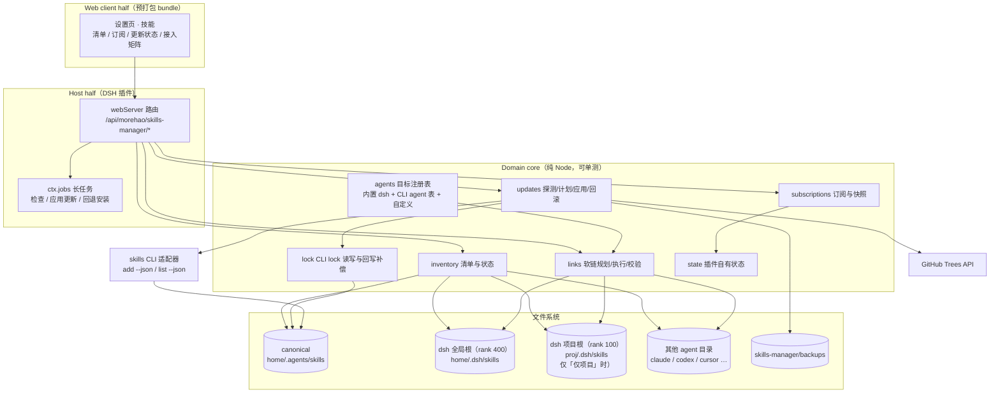
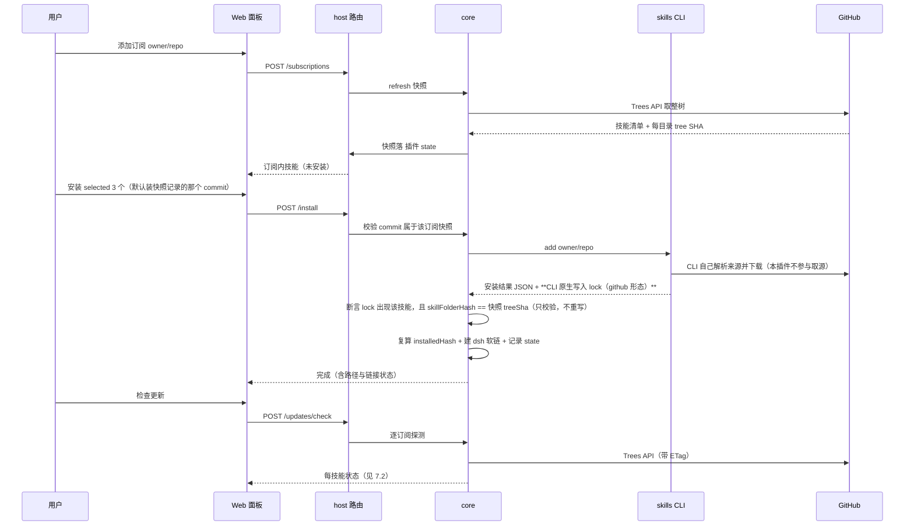
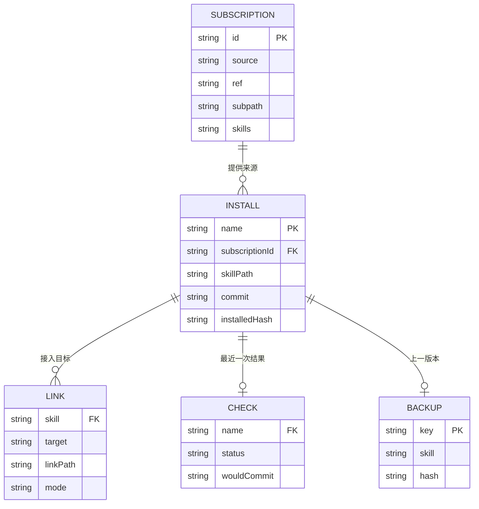
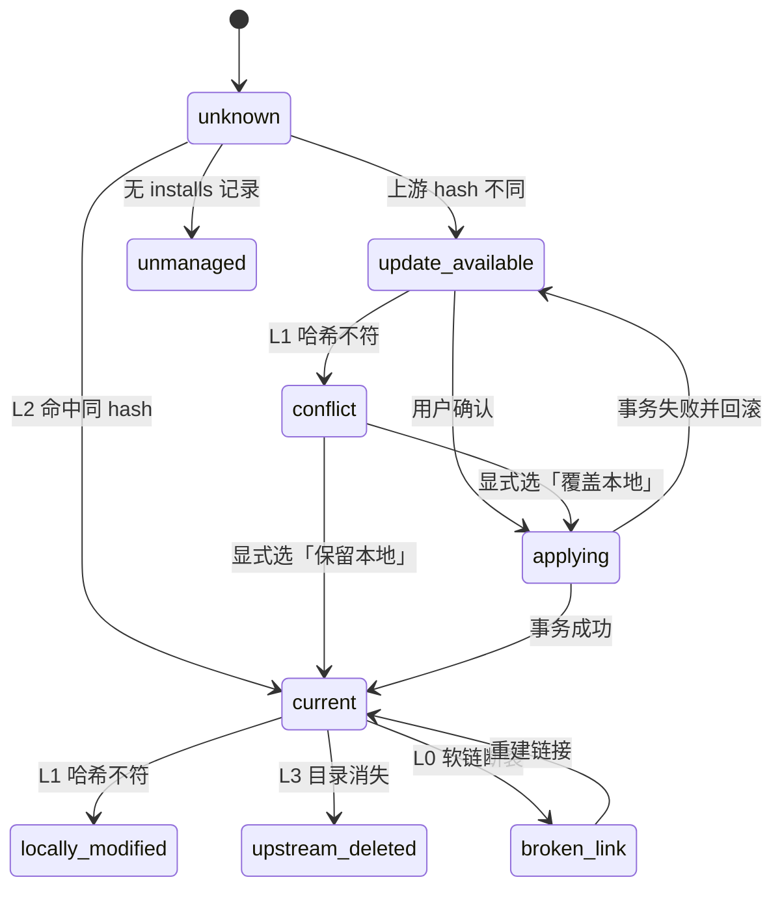
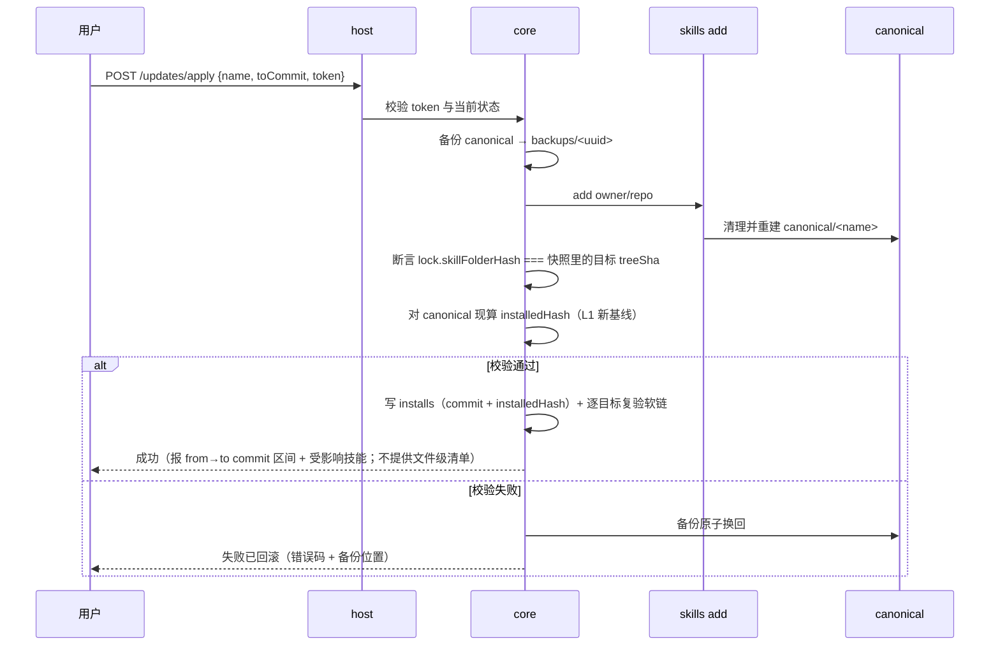
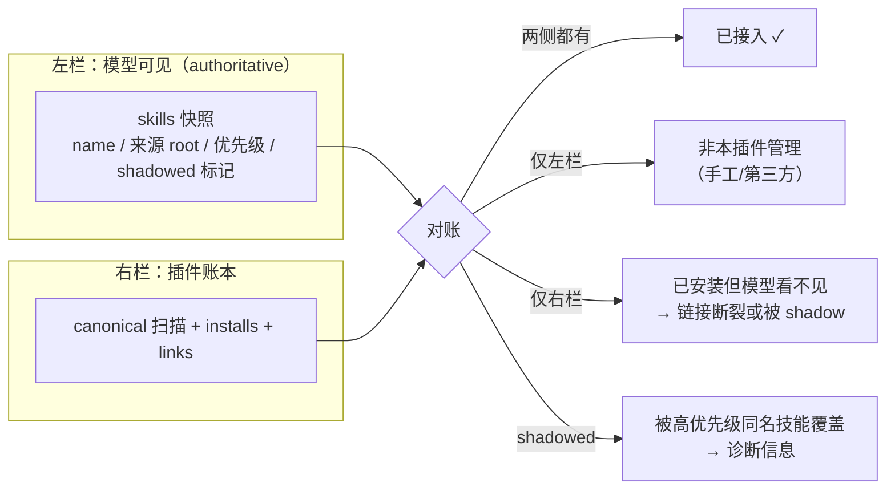
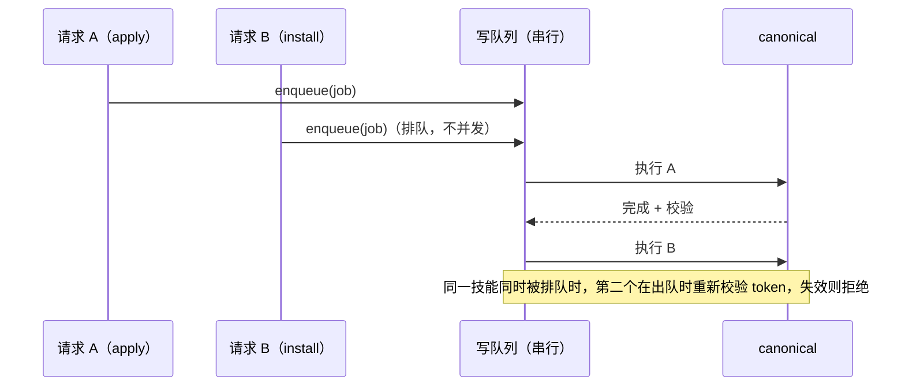

# 技能管理（dsh-skills-manager）插件设计

- 日期：2026-10-23
- 状态：**草案待评**（评审轮 1 已并入；Q1–Q6 全部拍板、差异预览明确不做，见 §14.6）
- 作者：morehao　评审人：待定　拍板人：待定（新插件，需 owner 自定）
- 落点：**新系统**（独立 DSH Web 插件；本轮只出方案，不建仓）
- 边界：本设计**完全独立**，不复用、不继承本机任何既有插件模块；§2 的取证只采信上游 `skills` CLI 与本机文件系统。
- 配套：命名见 §15；界面与交互见 [界面原型设计](./2026-10-23-dsh-skills-manager-prototype-design.md)（含页面清单、slot 映射、状态视觉、原型产物清单）。
- 档位：标准（子系统级：涉及 CLI 适配、软链拓扑、订阅与更新事务）
- 专题：架构设计 / 数据模型 / 安全
- 配图：本轮为草案，全部用 Mermaid 内联（便于评审时改文本 diff）；定稿评审后把「架构分层」与「更新状态机」两张结构图导出为同目录 SVG

## 1. 问题与目标

### 1.1 要解决什么

本机的 Agent 技能目前散落在两套机制之间：

- 官方 `skills` CLI（`npx skills`）已经把「下载 → 解析 → 落到 canonical `~/.agents/skills` → 给支持它的 agent 建软链 → 写 lock」这条链路做完了；
- 但 **DSH 不在 CLI 的 agent 表里**（F17：`-a` 取值走 agent 表白名单校验，1.7.4 的表里没有 `dsh`，也不建议打补丁），技能必须落进 `$DSH_HOME/skills` 才会进模型目录，这一步只能由插件自己建软链；
- 本机目前**没有任何持续状态视图**：装了哪些技能、各自来自哪个仓库的哪个 commit、上游变了没有、某个技能接到了哪些 agent —— 这些问题只能靠翻目录、读 lock、回忆自己做过什么来回答。一次性执行完就结束了，没有「后续」。

于是用户要的能力其实是三件事的合体：**可浏览的清单 + 可控的软链分发 + 可订阅、可追溯、可回退的更新**。前两件是「看得见与接得通」，第三件是「敢升级」——而"敢升级"靠的是**能退回上一版**，不是"能提前看每个文件的 diff"（后者本设计明确不做，见 §1.3 / §7.3）。

### 1.2 目标

| 类型 | 目标 | 验收口径 |
| --- | --- | --- |
| 业务 | 一次打开就能看清本机所有 canonical 技能与它们在各个 agent 的接入状态 | 面板首屏 ≤1s 出清单（本地扫描，无网络）[假设：200 个技能、SSD、冷启动无缓存，待实测] |
| 业务 | 任意 agent（含新出现的 agent）接入/断开技能是「勾一下就生效」 | 单个技能接入 ≤300ms，批量 20 个 ≤3s [假设：本地 FS 操作，待实测] |
| 技术 | 技能内容只由 `skills` CLI 写入，插件不手改 canonical | 任意写操作后 `skills list --json` 仍能完整识别 |
| 技术 | 更新检测**不依赖克隆**即可判断「上游是否变」 | 每仓库每 ref 1 次 GitHub Trees 调用；重复检查命中 ETag 时 0 次 |
| 技术 | 更新可回退 | 应用后能从备份恢复到应用前的字节级一致 |

### 1.3 非目标（明确不做）

- **不做技能市场/搜索**：找技能是 `npx skills find` 与 skills.sh 的事，本插件只管理"已经在我机器上的"。
- **不接管 CLI 已有的 agent 分发**：CLI 支持的 100+ agent 目录表我们只读取用于展示与手动接入，不重写它的 add 分发逻辑（否则等于分叉上游）。
- **不给 CLI 打补丁**：不改 CLI 的 agent 表去注册 `dsh`（见 I5）。补丁一旦被 CLI 升级覆盖就会静默失效，且污染全局安装。
- **不做技能内容编辑**：第一版只读正文，不提供编辑器——`add` 会整份重建目标目录（F12），本地改写会在下次更新时被覆盖，提供一个会被覆盖的编辑器只会制造"我改过"的错觉。
- **不做私有源凭证管理**：私有仓需要 `GITHUB_TOKEN` 时由环境变量提供（F4 的 lock 写入路径即从环境读取），插件不落盘任何 token。
- **不做文件级差异预览**：不提供"更新前后逐文件 added/removed/modified"。理由是它要求每次"看看变了什么"都付一次克隆，而"敢升级"依赖的是备份 + 回滚。面板只给 commit 区间与受影响技能，要看具体行就复制一条 `git diff <from>..<to> -- <skillDir>` 到终端。
- **不做跨机器同步**：插件状态是本机的，不同步。

## 2. 既有资产与硬约束（取证）

设计直接建立在这些**已核对过源码**的事实上，改实现前请重读对应锚点。

**取证基线**：`skills@1.7.4`（npm 最新版，本轮实读其发布物）。上游只发布打包后的 `dist/`（无 `src/`），因此锚点统一写**包内 `dist/cli.mjs:<行号>`**；行号随版本变动，升级 CLI 后必须重跑 §12 的契约用例，不要照抄行号。

| # | 结论 | 证据锚点（`skills@1.7.4` `dist/cli.mjs`） |
| --- | --- | --- |
| F1 | canonical 目录 = `<homedir>/.agents/skills`（全局）；项目级 = `<cwd>/.agents/skills` | `getCanonicalSkillsDir()` :2210-2212；`AGENTS_DIR`/`SKILLS_SUBDIR` :1186-1187 |
| F2 | 安装有三种形态：`symlink`（canonical 存副本 + agent 目录软链到它）、`copy`、`link`（canonical 本身软链到源） | `installSkill` :2289-2370（软链 :2330、复制 :2332-2336、agent 侧软链 :2352） |
| F3 | universal 类 agent 的 base 直接就是 canonical，不额外建链；因此「装到 canonical」与「装到 universal」是同一件事 | `getAgentBaseDir` :2223-2224（`isUniversalAgent` → 直接返回 canonical） |
| F4 | 全局 lock `~/.agents/.skill-lock.json`（v3），逐技能记 `source/sourceType/sourceUrl/ref/skillPath/skillFolderHash` | `LOCK_FILE` :3754；`addSkillToLock` 调用 :5748-5756 |
| F5 | GitHub 源下 `skillFolderHash` 是**技能目录的 git tree SHA**（整目录任一文件变则变） | `getSkillFolderHashFromTree` :5741-5744；`getGitTreeHash`（`git rev-parse HEAD:<dir>`）:7910-7940 |
| F6 | 本地路径源下同一字段退化为**内容哈希** `sha256(Σ 按路径排序的 [相对路径 + 文件内容])` | `computeSkillFolderHash` :1137-1147；`collectFiles` :1148-1163 |
| F7 | 项目 lock 是另一个文件 `<cwd>/skills-lock.json`（v1），记 `computedHash`（内容哈希）、`skillPath`，无时间戳 | `LOCAL_LOCK_FILE`/`getLocalLockPath` :1093-1096；`addSkillToLocalLock` :5760-5770 |
| F8 | 检测上游变化的标准做法：一次 Trees API 取整树，再按 `dirname(skillPath)` 取该目录的 tree SHA 比对 | :7880-7897（整树 :7856-7874） |
| F9 | 不可检测来源有明确五类：本地路径 / 纯 git URL / well-known / 无 hash / 无 skillPath | `getSkipReason` :7600-7608 |
| F10 | `update` 内部 spawn 自己的 `add`，argv 为 `add <src> --skill <name> [--full-depth] -g -y`，**不带 `-a`** | :7951-7968 |
| F11 | `add --json` 必须同时给 `--yes`（或 `--all`），否则直接退出码 1 | :5306 |
| F12 | `add` 写入前对目标目录 `rm -rf` 后重建，不具备事务性 | `cleanAndCreateDirectory` :2230-2236，调用点 :2313 / :2514 / :2625 |
| F13 | 备份不能放在 `skills/` 下：任何含 `SKILL.md` 的子目录都会被当成技能扫到 | 技能发现目录表 :1196-1200 与 `discoverSkills` :1303-1400 |
| F14 | 从本地缓存安装会让 CLI 把 lock 写成「本地来源 + 内容哈希」，必须回写远端身份与 tree SHA | :5729-5756（`parsed.type === "local"` 分支 :5745-5747） |
| F15 | 托管判定必须是 `realpath(link) === realpath(canonical/<name>)`；同名真实目录一律不覆盖 | 本插件不变量（§4.2），上游无此概念 |
| F16 | 自定义 `$DSH_AGENTS_HOME` 不影响 canonical；dsh 侧靠自身软链层被看见 | 由 F1 推出（canonical 只认 `homedir()`） |
| F17 | `-a` 取值受 agent 表白名单校验，非法值直接退出；**1.7.4 的表里没有 `dsh`** | 校验 :5476-5479 / :7113 / :8526；表 `const agents` :1434-2155（全文件 grep `dsh` 零命中） |
| F18 | `skillPath` 是仓库内 `SKILL.md` 的**文件路径**（如 `skills/foo/SKILL.md`）；一切目录级运算先 `dirname` | :7888；`getGitTreeHash` :7910-7915 |
| F19 | 哈希方言**不是**按来源类型切换，而是 `sourceType === "github" && /^[0-9a-f]{40}$/.test(hash)` 双重判定 | :7888 |
| F20 | `list --json` 存在，但只返回 `name / path / scope / agents[displayName] / source / sourceUrl / sourceType`，**没有 ref / skillPath / skillFolderHash** | `runList` :7105；json 分支 :7137-7152 |
| F21 | `remove` 支持一次多个名字（`-s a b`）且支持 `-a`，但**没有 `--json`** | `parseRemoveOptions` :7441-7470；`removeCommand` :7238；无 json 分支 |
| F26 | 原生注册表 `ctx.skills` 提供 `registerProvider()`（同步、返回 disposer）与 `register()`；**分层裁决**：全局层 + agent preset 层，最近层赢，同层按 rank→注册顺序→提供方内部顺序 | DSH 内置 `@deepseek-ai/dsh-skill` README「注册表采用宿主 + 按 scope 的分层结构…最近层直接赢得重名」 |
| F27 | 每个技能带**四象限调用策略** `modelInvocable` × `userInvocable`；`disable-model-invocation` 只关模型侧，`/` 菜单仍会出现并标「仅限用户」 | 同上 README「每个 skill 上的调用策略…四种组合」；`dsh-client-ui-skill` README 明写该行为 |
| F28 | 原生文件系统 provider 扫 5 个根，带 rank：`project-dsh` 100 `<projectRoot>/.dsh/skills`、`project-agents` 200、`custom` 300、`user-dsh` 400 `<dshHome>/skills`、`user-agents` 500；**项目根 = 最近含 `.git` 的祖先**，无则 cwd；`user-dsh` 跳过 `.system`；根被 watch，增删无需重启 | `@deepseek-ai/dsh-skill-filesystem` README「根目录与优先级」与「变更检测」 |
| F29 | 技能格式：目录 bundle `<name>/SKILL.md` 或平铺 `<name>.md`，**刻意不支持嵌套 `**/SKILL.md`**；frontmatter 必填 `name`/`description`，可选 `whenToUse`/`metadata`/`disable-model-invocation`/`user-invocable`；**非法布尔值会让整条技能被丢弃（带 warning）** | 同上 README「skill 格式」 |
| F30 | 原生 provider 支持**符号链接的目录**作为技能条目；DSH 已有 `/` 菜单与 `/name` 加载（`dsh-client-ui-skill`）、持久目录 + `skill` 工具（`dsh-tool-skill`，描述截断默认 500 字符），但**没有安装/更新/删除类管理界面** | 两份 README；`dsh-tool-skill` 配置项 `catalogDescriptionMaxLength=500` |
| F25 | `remove` 未指定 `-a` 时 `targetAgents` = **全部 agent**，逐个 `rm -rf` 同名路径（不区分软链/实体目录）；canonical 仅在"其余 agent 都没留同名条目"时删除 | `removeCommand` :7238-7360（循环与 `isStillUsed` 判定） |
| F22 | lock 只在「全局安装 且 有规范化来源（或本地源且非直下载）」时写入；否则装完不记账 | :5729 |
| F23 | `universal` 条目自身的 `globalSkillsDir` 指向 `$XDG_CONFIG_HOME/agents/skills`，与 F1 的 canonical **不是同一路径** | :2148-2153 对比 :2210-2212 |
| F24 | `--full-depth` 只影响目录发现深度：不加时，一旦在搜索根命中一个 `SKILL.md` 就**提前 return**，不再下探 | 早退点 :1339；参数解析 :5975；GitHub 分支 :5084；语义见包内 `docs/creating-skills.md:56` |

**推论（本设计的关键前提）**：

1. **F17 → `-a universal` 是唯一可行值**，不是风格偏好；dsh 的接入必须由本插件自己的软链层完成，且禁止 patch agent 表（I5）。
2. **F19 + F18 → 哈希必须"形态配对"**：`sourceType` 与 hash 形态错配的两种组合都坏，且失败方向不对称（§7.5 重写）。这是本设计最容易静默出错的地方。
3. **F10 → 不能把更新委托给 `skills update`**：它自己 spawn 的 `add` 不带 `-a`，会把软链撒到检测到的全部 agent 目录。
4. **F12 + F13 → 更新必须「先备份到插件目录、再让 `add` 破坏性重建」**，备份落点不能进 `skills/`。
5. **F20 + F21 → 状态读取不能全靠 CLI 输出**：inventory 需要的 hash/ref 只能读 lock；卸载没有 JSON 回执，只能装完回磁盘核对（§8.2）。
6. **F14 + F22 → 不要自己代理来源**：一旦用本地缓存安装，lock 会被写成 local 形态、还可能指向已失效的路径，得再自己回写。因此安装**只走远端 URL**，也让"回写 lock"这件事彻底消失（§7.5、§17）。
7. **F23 → 枚举 agent 目录时不能直接信 `globalSkillsDir`**：`universal` 那条指向 XDG 配置文件目录，是给 CLI 内部提示用的，不是技能落点；用它枚举会扫到空目录。agent 注册表应以「canonical + 各 agent 真实 skills 目录」自建（§4.3）。

## 3. 方案总览

### 3.1 分层



唯一的网络依赖是 **GitHub Trees API**（每次检测 1 次请求，回答"上游变了吗"）。**本设计不依赖 `git`**：安装与更新全部交给 `skills` CLI，它自己负责取源；我们只在装完后做一次校验（§7.4）。

**DSH 侧靠原生根 + 软链**：往 `user-dsh` 根（rank 400，`~/.dsh/skills`）建链接是"装完就能用"的默认动作；项目维度改往 `project-dsh` 根（rank 100）。DSH 自己的发现、去重与刷新全部由原生机制承担，本插件不介入（§16）。

分层原则：**UI 不碰文件、core 不碰宿主 API、host half 只做协议与调度**。这样 core 可以在临时 HOME 下纯单测（测试纪律见 §12）。

### 3.2 三个写入者，各自只写自己的东西

这是整个方案的地基。任何越界都会破坏与 `npx skills` 的互操作。

| 写者 | 独占写什么 | 绝不写什么 |
| --- | --- | --- |
| `skills` CLI | canonical 技能目录内容、CLI lock | 不写插件的软链决策、不写插件状态 |
| 本插件 | `$DSH_HOME/skills` 与各 agent 目录下的软链、插件状态、备份目录 | 不直接写 canonical 里的文件（只能通过调 `add`） |
| 用户 | 自己的 agent 配置、手写技能 | —（插件对手写/非托管目录只读） |

由此得到三条不变量（另见 §17 的"为什么不是四条"）：

- **I1**：canonical 里每一个技能条目，都是某次 `skills add` 的产物（或用户手工放进去、被识别为 `unmanaged`）。
- **I2**：任何一个软链，都能在插件状态里找到创建记录；插件只清理自己记录过的链接。
- **I5**：**永不修改 CLI 自身的任何文件**（含 agent 表补丁、`node_modules` 内改动）；调用 CLI 时 `-a` 只允许 `universal`（F17）。理由：补丁会被 CLI 升级静默覆盖，而升级覆盖后的失败形态是"技能装进了一个不存在的 agent 目录"，排查成本远高于收益。

### 3.3 三条主链路的走法



上图有一条刻意的取舍：**安装走远端 URL，全部交给 CLI 取源**。

- 远端安装时 CLI 自己就以 github 形态写 lock，`sourceType` 与 `tree SHA` 天然配对，**我们根本不需要写 lock**；
- 本插件**不做任何克隆**：没有 cache 目录、没有 `git` 依赖；
- 更早的草稿写的是"先 clone 再 `add <本地路径>`"：把插件变成了来源代理，代价是 lock 被写成 local 形态（F14）→ 还得自己回写。这条路径已整条删除（§17）。

## 4. 软链拓扑与 agent 接入

### 4.1 拓扑

```
~/.agents/skills/<name>/                     ← canonical 真身（CLI 写的副本）
~/.dsh/skills/<name>  → ../../.agents/skills/<name>        ← rank 400，默认必需
<project>/.dsh/skills/<name> → …/canonical                 ← rank 100，仅"仅项目"模式
~/.claude/skills/<name> → ../../.agents/skills/<name>      ← 其他 Agent，勾选时
```

三处链接分别落进三个**原生根**（F28），因此完全复用 DSH 自己的发现与优先级：`~/.dsh/skills` 是 `user-dsh`（rank 400），项目目录是 `project-dsh`（rank 100），两者叠加但项目优先。

- **一律用相对软链**：`../../.agents/skills/<name>` 只有在 DSH/agent 目录与 canonical 同层（都在 home 或都在项目根下）时才成立；跨层的情况（如 `~/.config/opencode/skills`）按实际路径算相对距离，算不出来就退回绝对路径并在 UI 标注「此链接不可跨机器迁移」。
- Windows 用 junction（对齐 CLI 的做法：`createSymlink` :2249-2270，`win32` 下 `symlinkType = "junction"` 且目标必须用解析后的绝对路径，非 Win 才用相对路径）。
- dsh 的全局目标 `~/.dsh/skills` 是内置的、总是建立；`<project>/.dsh/skills` **只在显式「接到项目」时建立**（§4.6）。其余 agent 的全局目标是**可选集合**（跟随页头设置）。

### 4.2 托管判定与「不覆盖」原则

判定一个 `<agentDir>/<name>` 的四态（比三态多一态，是被 §2 推论 5 逼出来的）：

| 状态 | 判据 | 面板行为 |
| --- | --- | --- |
| `managed` | `realpath(link) === realpath(canonical/<name>)` 且 `SKILL.md` 可读，**且 插件 state 有创建记录** | 可断开（删除链接） |
| `managed-external` | `realpath(link) === realpath(canonical/<name>)` 且 `SKILL.md` 可读，**但 state 无记录** | 展示为「已接入（非本插件创建）」；提供「接管」写一条记录；**不提供删除** |
| `foreign-link` | 是软链但指向别处（含悬空） | 只读展示 + 提示「非本插件创建，不动」 |
| `real` | 真实目录/文件 | 只读展示 + 提示「本地实体，如需接管请自行移走」 |

`managed-external` 为什么必须存在：`skills list --json` 会返回每个技能已接入的 agent 显示名（F20），说明**CLI 侧本来就可能是某条链接的创建者**；若把这类链接一律当 `foreign-link`，用户会看到"明明接好了却显示不可管理"，进而去手工 `rm`。判据即可用 F20 的 `agents[]` 做交叉确认。

**绝不覆盖**：这是本插件自定的不变量（F15），不来自上游。理由是插件无法区分「用户手工放的真实目录」与「别的工具写的东西」，覆盖一次就可能毁掉别人的工作，而收益只是省一次手工操作。

### 4.3 新 agent 的「一键接入」

用户提出的关键诉求：**以后本地多了新 agent，要能方便地把它接进来**。设计成三段：

1. **发现**：agent 目标注册表 = 内置 dsh 两项 + 一张**自建的** agent 目录表（只收「真身落点」，见下方警告）+ 用户在 state 里手工添加的自定义目录。发现逻辑只做 `lstat` 探测根目录是否存在，**不递归**。
   > ⚠️ 不要直接枚举 CLI 的 `globalSkillsDir`（F23）：`universal` 那条指向 `$XDG_CONFIG_HOME/agents/skills`，是提示用的伪路径，不是技能落点。可用它做「这个 agent 是否装了」的探测信号，但目标目录一律以 canonical（F1）与各 agent 自身 `skillsDir` 的实测结果为准。
2. **提示**：面板顶部出现「发现 2 个新 agent 目录（cursor、codex），是否接入当前 N 个技能？」，给出三个选项：全部接入 / 挑选技能 / 暂不。
3. **执行**：批量建链是一次串行任务（走 `ctx.jobs`），逐条幂等：已存在且已托管 → 跳过；`foreign-link`/`real` → 记入跳过清单并说明原因；失败 → 收集错误继续下一条，不整批回滚（建链是加法，单条失败没有一致性风险）。

"便捷"落在两点：**新 agent 只需一次点击** + **接入矩阵一屏可见**（行=技能，列=目标，格子=已接入/可接入/不可接入/被占用）。

### 4.4 卸载、改名与冲突

- **卸载也走 CLI**（终局，见 §8.2 与下方「删除序列」）：`skills remove -s <name> -g -y` —— 真身与 CLI 认识的所有 agent 目录里的条目都由 CLI 清理，插件只清理**自己记录的**链接（dsh 两个目标 + 自定义目标）。canonical 一律不由插件直接 `rm`（I1）。
- 改名（上游改了 frontmatter `name`）：视为「删旧名 + 装新名」，旧名的链接进回收站记录，避免留悬空链。
- 同名冲突（canonical 已有同名，来自另一个订阅）：**拒绝并提示**，不做自动覆盖——同名技能在多个来源同时存在时，覆盖谁都是猜。

**删除序列（插件侧编排，五步）**

1. **前置体检**：列出 CLI 这次会触及的每个 agent 目录下同名条目；若其中有 `real`（真实目录）或 `foreign-link`（指向别处），**中止**并提示"X 里有一个不是本插件创建的 `foo`，继续会让 CLI 连带删掉它，请先自行移走"。理由见下方"为什么必须体检"。
2. **快照**（默认开）：把 canonical/<name> 复制到 `skills-manager/trash/<name>-<ts>/`，写入 trash 索引（保留 7 天，可恢复）。
3. **调 CLI**：`skills remove -s <name> -g -y`（**不带 `-a`**）。
4. **清自家链接**：删除 state 里记录的 dsh 与自定义目标链接；复验是否还有残留（悬空链接一并清）。
5. **清记账**：删 `installs` 记录（含 `mode`）、`links` 记录；`remove` 无 `--json`，全部结论以磁盘核对为准。

**为什么必须体检（CLI 的真实语义）**：`remove` 在未指定 `-a` 时把 `targetAgents` 设为**全部 agent**，并逐个 `rm -rf` 这些目录下的同名路径（`dist/cli.mjs` removeCommand 内循环），它**不区分**那是本插件建的软链、别人建的软链，还是用户手放的实体目录。所以"交给 CLI"之前必须替它做类型判断，否则一次删除会连坐别人的技能。

**为什么 remove 不能带 `-a`**（与 add 恰好相反）：canonical 只在 `!isStillUsed` 时才被删除，而 `isStillUsed` 看的是"不在 targetAgents 里的 agent 是否还留着同名条目"。若传 `-a universal`，claude/codex 的链接会被算作"仍在使用"→ **真身永远删不掉**，CLI 却回报成功。`add` 必带 `-a universal`（F17），`remove` 必不带 `-a` —— 两个命令方向相反，这是本契约最容易写错的一处。

### 4.5 默认链接策略（终局）

「链接到 Agent」是**概念**，但不再是一个按钮。安装完成后由策略决定链到谁：

**本插件默认只关注全局技能**：canonical 是 `~/.agents/skills`，可见性只往全局 Agent 目录里写。项目维度不是默认路径，而是一个**独立动作**（见下方"接到项目"）。

| 目标 | 默认 | 理由 |
| --- | --- | --- |
| **DSH 全局**（`~/.dsh/skills`，原生 rank 400） | **总是建立，不可取消** | 装进 canonical 却不在这个根里 = 对 DSH 等于没装。它是默认动作，不是选项（§16.1） |
| 其他 Agent 的全局目录（Claude Code / Codex / Cursor…） | **跟随页头设置「自动链接」，默认开**，范围 = 安装时已探测到的目录 | 绝大多数人只想要"装完就能用"；默认关会让每个技能都要多点一次 |
| 项目作用域 | **不自动**，只能显式操作 | 项目维度是例外诉求；且它现在只是 state 上的一条记录（§16.4），不写任何项目目录 |

两条硬约束：

1. **例外必须有出口**：行内显示 `可用：DSH、Claude Code（调整）`，那个「调整」是文字链（不是按钮），打开目标面板，可对单个技能取消或追加链接。若完全不给出口，自动往 `~/.claude/skills` 这类不属于本插件的目录写链接就变成了**不可撤销**动作，用户只能去命令行 `rm` —— 这比多一个文字链糟得多。
2. **冲突不覆盖**：目标目录里已有同名真实目录或外部链接 → 跳过并在结果里点名（§4.2 四态判定）；自动链接失败**不能**让安装整体失败。

### 4.6 作用范围：全局 / 仅某些项目（不是"加一个项目"）

**先修一个语义错误**：上一版把项目当成"额外可见"——即"接到项目 P 后，在 P 里也能用它"。但全局链一建，DSH 在任何 cwd 下都已经能看到它（rank 400），再来一条项目链只是重复一条同名条目，**没有任何额外效果**。所以项目段的真正语义只能是反过来的——**限制作用范围**：

| 作用范围 | 写哪条链 | 效果 |
| --- | --- | --- |
| **全局**（默认） | `~/.dsh/skills/<name>` | 任何 cwd 都可见（rank 400） |
| **仅这些项目** | 只写 `<projectRoot>/.dsh/skills/<name>`，**不写全局链** | 只有这些项目可见（rank 100）；其他 cwd 查不到 |

这才是用户说"这个规范只在我那几个仓库里有效"时想要的东西。

规则：

1. **多选**：一处配置可同时指定多个项目。选一个项目只能单选是伪需求——同一份内部规范通常服务于好几个仓库，单选会逼用户重复 N 次、并把状态打散成 N 条互不相干的记录。
2. **与 Agent 链接正交**：作用范围管"在 DSH 里哪些 cwd 可见"；Agent 链接管"哪些其他 Agent 的目录里有软链"。两者可自由组合（例如：全局可见 + 只链给 Claude Code）。
3. **它是"链接写在哪"的选择，不是状态过滤**：全局 = 写全局根；仅项目 = 只写这些项目根。因为原生是"多根 + rank 优先"（§16.4），两条同时写没有额外效果，所以 UI 做成单选；`scopeProjects` 仍记在 state 里，用于启停后按原样重建链接。
4. **项目根按原生定义**：最近含 `.git` 的祖先（F28）；选择器只提供已登记工作区作为入口，不接受手输路径；路径失效 → 报明确错误，不回退全局。
5. **一处提交**：作用范围与 Agent 链接同在「接入设置」面板里，**只有一个「保存」**（不再有独立的「接到项目」动作——同一个弹层里两个提交按钮会让用户不知道按哪个）。
6. **删除/断开**：删除技能时一并清理；项目作用域不影响真身位置。

设置入口：**页头一个设置 chip**（`自动链接：DSH、Claude Code ▾`），紧挨主按钮，两个 tab 都在。它决定"点添加之后会发生什么"，属于动作前置条件，所以放在动作旁边而不是列表底部——放底部时用户不滚到底就不知道装完会往 `~/.claude/skills` 写东西。

## 5. 数据模型：三本账

### 5.1 为什么需要三本账

| 账本 | 归属 | 记录什么 | 为什么不能只留一本 |
| --- | --- | --- | --- |
| canonical 文件树 | 文件系统 | 技能真身 | 这是唯一事实，但读不出"从哪来" |
| CLI lock | `skills` CLI | 来源、ref、skillPath、hash | 跨工具共享，但**语义有限**：没有订阅、没有"我接入到了哪些 agent"，而且**会被静默丢弃**——`readSkillLock` 在 `version` 缺失或低于当前版本（`CURRENT_VERSION = 3`）时直接返回空 lock，下一次写入就把原文件整份覆盖（:3755 / :3761-3771）。这是"插件 state 必须能独立存活"的硬理由 |
| 插件 state | 本插件 | 订阅、接入矩阵、检查结果、备份索引、操作历史 | 自己的账，可与 CLI lock 解耦；CLI lock 丢了也能靠 state + canonical 重建大部分信息 |

### 5.2 实体与字段

**A. 接入记录（links）**——一行 = 一个技能在一个目标上的期望状态。

| 字段 | 类型 | 说明 |
| --- | --- | --- |
| `skill` | string | canonical 目录名（= 技能名，kebab） |
| `target` | string | `dsh-global` / `agent:<agentKey>` / `project:<absPath>`（仅 §4.6 显式操作时产生） / `custom:<id>` |
| `agentDir` | string | 目标根目录绝对路径（写入前必须能由注册表推出，拒绝任意路径） |
| `linkPath` | string | 实际软链路径 `<agentDir>/<skill>` |
| `mode` | `"relative" \| "absolute" \| "junction"` | 建链形态 |
| `createdAt` | string | ISO |

**B. 订阅（subscriptions）**

| 字段 | 类型 | 说明 |
| --- | --- | --- |
| `id` | string | `sha256(source+ref+subpath)` 前 16 位，稳定可重算 |
| `source` | string | `owner/repo` 或 https URL（只接受公开源） |
| `ref` | string? | 分支/tag；空=默认分支 |
| `subpath` | string? | 仓库内子目录 |
| `skills` | `"*" \| string[]` | 订阅范围（只影响"列出/安装哪些"，不自动装） |
| `lastCheck` | object? | `{ at, commit, treeEtag, status }` |
| `snapshot` | object? | `{ commit, entries: [{ name, skillPath, treeSha, description }] }` |

**C. 装出来的技能（installs）**——一行 = 一个 canonical 技能。

| 字段 | 类型 | 说明 |
| --- | --- | --- |
| `name` | string | 技能名 |
| `subscriptionId` | string? | 来自订阅；空 = 手工/其他工具装的（`unmanaged`） |
| `skillPath` | string | 源仓内 **`SKILL.md` 相对路径**（如 `skills/foo/SKILL.md`，不是目录；见 F18） |
| `ref` | string? | 安装时请求的 ref（分支/tag/或直接是 commit）；远端安装即 `add` 用的 `#ref` 片段 |
| `commit` | string | 那次安装实际对应的 commit（40 位）。**注意：CLI 的 lock 不记 commit**（F4），本字段由插件自己解析 Trees/commits API 得到并落库；拿不到时置 `null` 并在 UI 标"commit 未知"，不要瞎填 |
| `commit` 校验 | — | 不再单独存 tree SHA：lock 的 `skillFolderHash` 就是权威（CLI 写的），装完只做一次断言（§7.4） |
| `installedHash` | string | 安装完成后对 canonical 目录现算的内容哈希，仅作"本地是否被改过"的基线；**只在更新前算一次比对**，不做常驻轮询（§17） |
| `installedAt` / `updatedAt` | string | ISO |
| `mode` | `"on" \| "off"`（预留 `"manual"`） | 启停状态，只存 插件 state，永不写 `SKILL.md`（§14.2）。默认 `"on"`；删除技能清记录，回收站恢复保留原值 |
| `scopeProjects` | string[] | 作用范围：空 = 全局；非空 = 仅这些项目根下可见（§4.6、§16.4）。多选，不写任何项目目录 |
| `backup` | object? | `{ key, hash }`：上一个版本的备份 |

**D. 检查结果（checks）**——可丢弃的缓存，按技能存：`{ name, status, wouldCommit, checkedAt, detail }`。

### 5.3 实体关系



说明：不是数据库，落地为一个 JSON 文件（附录 A）。没有索引/DDL，读取规模是「几十到几百条」量级，全量读入内存即可；写入用「临时文件 + rename」的原子写，避免半截 JSON。

## 6. 订阅模型

- **订阅 ≠ 安装**。添加订阅只做两件事：记录来源范围 + 拉一次快照（技能清单 + 每个技能目录的 tree SHA）。不写任何技能文件。
- **刷新 ≠ 更新**。刷新只重算快照，标出「上游新增了 2 个技能 / 有 3 个技能变了」，是否安装/更新由用户点。
- 订阅与技能是多对多：一个仓库可提供多个技能，一个技能只归属一个订阅（同名冲突直接拒绝，见 4.4）。
- 为什么不做「订阅即自动跟随」：自动跟随等于把上游的一次误提交直接推进生产技能目录。默认手动，后续可作为可选项（P3）。
- **订阅是全局的，启用是本地的**（§14.6 Q4 结论）：订阅、来源、`installs` 记在全局 state；"这个技能在当前项目里是否启用/是否只对手动调用开放"记在项目内的 `.dsh/dsh-skills-manager.json`，可选纳入 git。理由：订阅描述"我关注了哪些上游"（跨项目同一份），启用描述"这个仓库要哪些技能"（应该随仓库走）。
- **安装默认锁定快照里的 commit**，而不是"此刻的分支头"：`add owner/repo#<commit>`。这样"检查—计划—应用"三步看的是同一个对象；跟随分支是订阅上的一个可选开关（默认关）。

## 7. 更新机制（核心章）

### 7.1 四层校验：每层只回答一个问题

| 层 | 问题 | 手段 | 成本 | 失败含义 |
| --- | --- | --- | --- | --- |
| L0 存在性 | 东西还在吗？ | `lstat` canonical 目录 + `realpath` 每条软链 | 本地，O(技能数) | `missing` / `broken-link` |
| L1 本地完整性 | 有人动过吗？ | 重算 canonical 目录内容哈希，与 `installs[].installedHash` 比 | 本地读全部文件 | `locally-modified` |
| L2 上游变化 | 上游变了吗？ | Trees API 取整树 → 取 `dirname(skillPath)` 目录的 tree SHA（F18），与 **lock 里 CLI 写的 `skillFolderHash`** 比 | 1 次 API/仓库·ref | `current` / `update-available` |
| L3 上游存在性 | 上游还留着它吗？ | 整树里找不到该 `skillPath` | 复用 L2 的响应 | `upstream-deleted` |

L1 先于 L2 是刻意的：**本地改动是阻断条件，不是提示**。如果本地被人改过，即使上游也变了，也不能默默覆盖。

### 7.2 状态机



| 状态 | 面板文案要点 | 可执行动作 |
| --- | --- | --- |
| `current` | 已是最新（检查于 x 分钟前） | 查看正文 / 重新检查 |
| `update_available` | 有更新（commit 7a1c → 9f02） | 生成计划 → 应用（显示 commit 区间与受影响技能，不提供文件级 diff） |
| `locally_modified` | 本地已改动，不再跟随上游 | 查看改动 / 导出备份 / 重置为上游 |
| `conflict` | 本地有改动且上游也变了 | 覆盖（先备份）/ 保留本地 / 忽略该版本 |
| `upstream_deleted` | 上游已移除该技能 | 保留（转 unmanaged）/ 卸载 |
| `unmanaged` | 手工或第三方安装，未纳入追踪 | 只读展示；可「接管」（补一条 installs 记录） |
| `broken_link` | 链接目标不存在 | 重建 / 清除链接 |

### 7.3 为什么不复用 `skills check` / `skills update`

| 维度 | `skills update` | 本设计 |
| --- | --- | --- |
| 交互 | 交互式选 scope / 确认删除，`-y` 只是跳过 prompt | 纯 API，面板驱动 |
| 目标 agent | 内部 `spawn add -g -y` 且**不带 `-a`**，可能铺到全部检测到的 agent（F10） | 显式 `-a universal -g`，agent 接入由我们自己的软链层负责 |
| 预览 | 有（文件级 added/removed/modified） | **明确不做**：只给 commit 区间 + 受影响技能；要看具体行，面板一键复制 `git diff <from>..<to> -- <skillDir>` 到终端 |
| 本地改动 | 不区分 | L1 强制阻断 |
| 回退 | 无 | 备份 + 事务 + 一键回滚 |
| 检测粒度 | 有（tree SHA） | 复用同一算法（保证与 CLI 判定一致） |

结论：**检测算法复刻上游（保证与 `npx skills update` 结论一致），执行路径自己掌控**。差异预览一栏是本设计主动放弃的能力：它把一次零成本的检测变成一次必付的克隆，而用户真正需要的是"装错了能退回去"——那是备份 + 回滚（§7.4）的职责，不是 diff 的职责。

### 7.4 应用更新的事务



关键点与理由：

1. **备份必须在调用 `add` 之前**：`add` 会先 `rm -rf` 目标目录再重建（F12），不具事务性。
2. **备份不进 `skills/`**：备份落 `skills-manager/backups`（F13：任何含 `SKILL.md` 的子目录都会被当成技能扫到）。安装本身不落任何中间目录。
3. **token 防并发**：`token = sha256(subscriptionId + from + toCommit + installedHash + 目标列表)`，应用时必须原样带回；磁盘或上游在**计划**之后被改动 → 拒绝。
4. **校验分两层，别混成一层**：
   - **装对版本**：比对 CLI 写进 lock 的 `skillFolderHash` 与快照里 `toCommit` 的目标 `treeSha`（零额外成本，且这正是 L2 用的同一个值）；
   - **建 L1 基线**：`installedHash` 必须**对安装后的 canonical 目录现算**（不是从上游源算）。它的语义是"装完那一刻磁盘上是什么"，只用于检测之后的本地改动；从源算出来的值一旦有换行/编码差异，就会让 L1 永久误报。
5. **失败不允许静默**：回滚失败时保留备份目录并报 `error.skills.rollback-failed`，提示"请勿重复操作"。
6. **不替 CLI 记账**：主路径永远远端安装，lock 的 `sourceType/skillFolderHash` 由 CLI 自己写对，我们不回写、不镜像。装完只做一次"lock 的 hash 是否等于快照里的 treeSha"的断言；不等就重试一次，仍不等则报错——**不做本地缓存安装这条备用路径**（那是上一版的自造负担，已删）。

### 7.5 哈希：lock 是权威，我们只读不写（评审轮 2 收敛）

上一版花了整节讨论"哈希方言"，前提是**我们自己往 lock 里写 hash**（本地缓存安装 → local 形态 → 回写）。删掉那条路径后（§17），整节可以塌缩成三句话：

1. **唯一权威是 CLI 写的 lock**：远端安装 → `sourceType=github` + 40 位 tree SHA，天然自洽；
2. **检测只做比对**：Trees API 取 `dirname(skillPath)` 的 tree SHA，与 lock 的 `skillFolderHash` 比——数值口径本来就一致，不存在方言问题；
3. **我们只算一种哈希**：`installedHash`（内容哈希），用途单一——"本地有没有被改过"。CLI 不暴露这个能力，所以必须复刻其算法（F6：只收普通文件、跳过 `.git`/`node_modules`、`/` 归一、`localeCompare` 排序、`update(path)+update(content)`、sha256）。**这是全设计唯一必须自己实现的算法**，且只在更新前算一次。

不再需要的东西：`installs[].upstreamTreeSha`（lock 里有）、`installs[].hashAlgo`（不会再有第二种形态）、以及"回写 lock"这个动作本身（I3 取消）。

### 7.6 成本、限流与降级

| 项 | 值 | 口径与来源 |
| --- | --- | --- |
| 检测成本 | 每仓库每 ref 1 次 Trees API | F8：先用一次请求取整树，再在本地按 `dirname(skillPath)` 比对；20 技能 / 5 仓库 = 5 次/轮 |
| 未认证限流 | 60 次/小时/IP | 上游源码未体现；**两处独立生态实现（dsh-agents-skills、dsh-skillbox）口径一致**，作为设计预算采信 |
| 带 token 限流 | 5000 次/小时 | 同上；`GITHUB_TOKEN` / `GH_TOKEN` 由环境变量提供，不落盘 |
| 手动检查间隔 | 最小 60s 去抖 | 设计约定，防止用户连点 |
| 自动检查 TTL | 10 分钟 | 设计自定预算（可配 `DSH_SKILLS_MANAGER_CACHE_TTL_MS`）；不是对上游行为的模仿 |
| 单次检测总耗时 | 5 仓库并发 ≤2s [假设] | 假设 API P95 300ms + 并发 5；待实测 |
| 安装耗时 | 远端安装单技能 2–10s [假设]（CLI 内部自行拉取） | 取决于仓库体积；本插件零 clone、零中间目录 |

**ETag 使用规则（必须写死，否则会误清快照）**：Trees API 的 `ETag` 是**整响应级**，缓存键必须是 `(repo, ref, commit)`；收到 304 时**只能复用上次的 tree 数据并刷新 `checkedAt`**，绝不可把 `snapshot.entries` 置空——否则一次"未变化"的检查会把面板打成"技能全丢"，进而触发 `upstream_deleted` 误判。

降级矩阵：

| 失败 | 表现 | 处理 |
| --- | --- | --- |
| API 401/403（限流/私有仓） | 该订阅本轮 `unknown` | 提示配置 `GITHUB_TOKEN`；不重试轰炸 |
| API 404 | `upstream_deleted`（仓库不可见） | 标注「仓库不可见或已删除」，不自动卸载 |
| 网络超时 | `unknown` | 保留上次结果并标"未确认"，UI 灰显时间 |
| ETag 未变 | 0 请求体 | 直接 `current` |
| `git` 不可用 | 安装/更新不可用 | 面板禁用写操作，显示前置条件 |

### 7.7 边界情形

- **ref 漂移**：订阅可选 `ref`；不指定时锁"检查时的 commit"而不是"分支最新"，避免"分支一动就全员更新"。用户可显式「跟随分支」。
- **subpath 变化**：快照里记录 `skillPath`；上游把技能挪目录 → 视为「删除旧路径 + 新增新路径」，不自动迁移。
- **技能改名**：按 4.4 处理。
- **一个仓库多个 ref 下的同名技能**：key 用 `(source, ref)`，两个 ref 各自独立判定（上游 CLI 同样按 `source + "\n" + ref` 分组，`dist/cli.mjs:7843`、:8050）。
- **canonical 被别的工具直接改**：L1 抓出来 → `locally_modified`，不覆盖。

## 8. 接口设计

### 8.1 HTTP 路由（全部 loopback/trustedHosts + 自定义头）

| 方法 | 路径 | 作用 | 关键参数 |
| --- | --- | --- | --- |
| GET | `/state` | **双栏对账**：`visible`（模型实际可见的快照）+ `ledger`（canonical/installs/links）+ 订阅 + 上次检查摘要 | `workspace?` |
| GET | `/agents` | 目标注册表 + 新发现 | — |
| POST | `/subscriptions` | 添加订阅并拉快照 | `{source, ref?, subpath?, skills?}` |
| POST | `/subscriptions/:id/refresh` | 重算快照 | `{force?}` |
| DELETE | `/subscriptions/:id` | 移除订阅（不卸载已装技能） | `{keepInstalled:true}` |
| POST | `/install` | 装选定技能（默认锁快照 commit，走远端安装） | `{subscriptionId, skills[], targets[], commit?}` |
| POST | `/links` | 接入/断开 | `{skill, targets[], action}` |
| POST | `/updates/check` | 检测 | `{names?, subscriptionId?}` |
| POST | `/updates/plan` | 生成应用计划：返回 `token` + `{fromCommit, toCommit}` + 受影响技能（**不含文件差异**） | `{name}` |
| POST | `/updates/apply` | 应用 | `{name, token, overwrite?}` |
| POST | `/updates/rollback` | 回退到上一版 | `{name}` |
| GET | `/skills/:name` | 技能正文 | — |
| POST | `/skills/:name/mode` | 启停（只改 插件 state，不动文件、不动链接） | `{ mode: "on" \| "off" }` |
| GET | `/diagnostics` | CLI 版本与能力位、canonical/lock 路径与条目数、哈希形态配对断言、上次检查时间、失败计数 | — |

**界面范围（终局）**：界面消费 8 个接口（详见原型文档 §8）——`GET /state`、`POST /install`、订阅三件套、`POST /updates/apply`、`POST /links`、`DELETE /skills/:name`、`POST /skills/:name/mode`。仅 `/diagnostics` 与 `/updates/plan` 不实现（对账信息降级为日志；不做差异预览，见 §14.6 Q6）。

### 8.2 CLI 适配器契约（唯一允许的子进程面）

| 用途 | 命令 | 参数约束 | 返回/回执 |
| --- | --- | --- | --- |
| 列已装技能 | `skills list --json -g` | 只读；`-g` 全局，项目级去掉 `-g` 单独跑 | JSON 数组，字段仅 `name / path / scope / agents[] / source / sourceUrl / sourceType`（F20）——**无 ref / skillPath / hash**，这三样必须直读 lock |
| 安装 | `skills add <source> --skill <name>… -a universal -g -y --json --full-depth`，其中 `<source>` **默认是 `owner/repo#ref`**（`ref` 取快照的 commit，见 §14.6 Q1；`#ref` 语法由 CLI 的 `parseFragmentRef` 支持） | `-a universal` 必带（F17）；`--json` 必须配 `-y`（F11）；**`--full-depth` 必带**（F24，不加则 GitHub 源浅层命中即停，多技能仓库会漏装）；永不带 `--all` 与 `-a '*'` | stdout 为 JSON（`add` 是唯一支持 `--json` 的写命令） |
| 卸载 | `skills remove -s <name>… -g -y` | **绝不带 `-a`**（否则 `isStillUsed` 恒真、canonical 残留）；调用前必须做"目标目录类型体检"（§4.4），避免连坐非本插件创建的实体目录；支持一次多个名字（F21）；**无 `--json`** | 无结构化回执 → 事后回磁盘 + lock 核对 |
| 列仓库内技能（降级） | `skills add <repo> -l --full-depth` | 不落盘、不写 lock、不吃 API 配额；**`--json` 与 `-l` 互斥**（:5307）→ 只能解析文本，仅作 Trees API 限流/无 token 时的降级 | 人类可读清单（名称 + 描述），**无 tree SHA** → 此时更新状态只能给 `unknown` |
| 版本与能力探测 | `skills --version`；以及一次 `add --help` 探测 `--json`/`--full-depth` 是否被支持 | 启动时做一次并缓存；不支持 `--full-depth` 时**禁用写操作**而不是降级跑（漏装比不可用更危险） | 版本号 + 能力位 |

**CLI 定位策略（四层，按序择优）**——这决定"能不能跑"，必须有确定顺序：

1. `DSH_SKILLS_MANAGER_CLI` 显式覆盖（测试桩 / 自定义安装方式）：视作「可执行文件 + 固定参数前缀」，不再追加任何 npx 参数，并**关闭 `--json`**（无法确认对方支持）。
2. 插件自带依赖里的 `skills`（`require.resolve("skills/package.json")` → `bin/cli.mjs`，用 `process.execPath` 直接跑）：省掉 npx 约 2–3s 解析开销，且不受 PATH 影响。
3. 回退 `npx -y skills`：先查 `PATH`，再**用登录 shell 反查**（GUI 启动的宿主常缺 fnm/nvm 的 per-shell 路径）。
4. 都不可用 → 抛错并给出可复制的完整手工命令，不做静默降级。

> 版本漂移风险见 R9：第 2 层是"安装插件那一刻解析到的版本"，第 3 层是"每次运行时现取 latest"，两条路可能不是同一版 CLI。

**子进程封装**：自建一个薄封装（无 shell 的 `spawn`、硬超时、输出上限、可 abort、argv 直传不经 `sh -c`），并统一注入非交互环境（`CI=1`、`NO_COLOR=1`、`TERM=dumb`、`GIT_TERMINAL_PROMPT=0`、`GIT_HTTP_LOW_SPEED_LIMIT/TIME`），否则 CLI 内部再 spawn 的 `git clone` 会卡在凭据提示上。

## 9. 安全与运维

### 9.1 写面白名单

- 可写目录只有三类：canonical（仅通过 CLI）、`~/.dsh/skills` 与 `<project>/.dsh/skills`、注册表内的 agent 目录。
- 请求里的路径参数一律不直接使用：由 `target` 标识（如 `agent:claude`）反查注册表得到真实路径，像 `isSameOrDescendant` 那样做包含校验，防路径穿越。
- 软链目标必须是 canonical 下的同名目录；不接受请求方指定软链目标。

### 9.2 破坏性操作

| 操作 | 保护 |
| --- | --- |
| 覆盖技能目录 | 先备份 + token 校验 + 本地改动阻断（7.4） |
| 删除软链 | 只删 state 记录过的 `managed`；`managed-external` 需先「接管」；`foreign-link` / `real` 一律不删 |
| 卸载 | **走 CLI**（`skills remove -s <name> -g -y`，不带 `-a`）+ 五步序列（§4.4）；调用前做目标目录类型体检，发现 `real`/`foreign-link` 即中止；canonical 不由插件直接删 |
| 清理体积 | 只清 `skills-manager/backups/*`（回收站/备份），不碰 canonical |
| 任意写操作并发 | 全局单写者队列（§14.3）：同进程内串联，跨进程由 CLI 自己的 lock 兜底 |

### 9.3 可观测

- 事件日志 `$DSH_HOME/skills-manager/dsh-skills-manager.log`（JSONL，滚动到 1MB 后 `.1`），记录：订阅刷新、检查结果、安装、更新、回滚、修复链接。
- 面板「诊断」页展示：CLI 版本、canonical 路径、lock 路径与条目数、上次检查时间、失败计数。

## 10. 选型对比

| 方案 | 做法 | 优点 | 代价 | 结论 |
| --- | --- | --- | --- | --- |
| **A 编排 + 复用 `add`（推荐）** | 自研清单/软链/订阅/更新事务，canonical 写入交给 CLI（**只走远端 `add owner/repo#commit`**，零本地缓存） | 与生态同构（其他 agent 直接可用）；复用 CLI 的源解析、frontmatter、重命名策略 | 要处理哈希方言与 lock 回写；受 CLI 行为变更影响，需契约测试 | 采纳 |
| B 只包装 `check`/`update` | 面板调用 CLI 已有命令 | 实现最省 | 无备份/回滚；交互式；`add` 可能铺到全部 agent（F10） | 否决 |
| C 完全自研下载安装 | 自己 clone、复制、写 agent 目录 | 完全可控 | 重写 100+ agent 目录表与源解析；失去与 `npx skills` 的互操作；维护成本最高 | 否决（除 P3 的私有源场景） |
| D 隔离 HOME 安装后「收养」 | 在一次性 HOME 里跑 `add`，只把产物目录搬进自己的技能根 | 天然免疫"CLI 写错位置"，不污染真实 agent 目录 | 隔离环境的 lock 不会被采纳 → 技能失去来源身份，还得自己补写锁（正是 §17 要消灭的那类自造）；用户后续 `npx skills update` 也看不见它 | 否决为主路径，详见 §14.5（可留作 P3「试用箱子」） |

## 11. 失败模式与降级矩阵

| 场景 | 现状行为 | 用户可见 | 恢复 |
| --- | --- | --- | --- |
| CLI 未安装 | 禁止安装/更新，只读清单仍可用 | 顶部横幅 + 安装命令 | 装好后点「刷新」 |
| CLI 版本过低（`--json` 不支持） | 回退到解析 stdout 的旧路径（仅用于 list） | 诊断页提示 | 升级 CLI |
| 网络不可达 | 检查 → `unknown`，安装/更新拒绝 | 灰显 + 原因 | 恢复后重试 |
| `add` 失败（源不可达/技能不存在） | canonical 可能已被清空 | 错误码 + 建议 | 自动回滚（有备份时） |
| `add` 报 `No matching skill found` | 与「技能确实不存在」不可区分（很可能是目录发现提前停） | 「可能漏装，已重试 3 次」 | 必带 `--full-depth` 并自动重试；仍失败才按"不存在"处理 |
| 检测恒 `current` 但上游确有变化 | 哈希形态错配（§7.5 表第 3 行） | **无任何提示** | 诊断页对每条 install 断言「`sourceType` 与 hash 位数是否配对」，不配对标红 |
| 用户要求"看看具体改了哪些文件" | 本设计不提供 | 面板给出 `git diff <from>..<to> -- <skillDir>` 一键复制 | —（有意为之，见 §1.3） |
| canonical 有目录但原生快照没有 | 技能「装了但 DSH 看不见」 | 行内标「DSH 无法解析」，附原因（缺 `description`／布尔拼错／名称非 kebab，F29） |
| 恒判「本地已改」 | 内容哈希未复刻 CLI 算法（§7.5 第 3 条） | 更新前总要二次确认 | 只影响提醒，不阻塞；诊断页可给「哈希自检」 |
| 回滚也失败 | 备份保留 | `error.skills.rollback-failed` + 备份路径 | 手工恢复 |
| `add` 不接受 commit ref | 装不到指定的那个 commit | 提示"已装到该分支最新，与预览的 commit 不同" | 退化为按 ref 安装 + 事后比对 treeSha；**不引入本地缓存安装**（§17） |
| 磁盘满 | 写入失败，状态不前进 | 错误码 | 清理备份（面板提供「清理旧备份」） |
| canonical 权限不足 | 只读模式 | 所有写操作禁用 | 修权限 |

## 12. 分期与验收

| 期 | 范围 | 验收 |
| --- | --- | --- |
| **P-1（先跑，1 天内）** | 三个 spike：① **`add owner/repo#<40 位 commit>` 能否按 commit 解析并安装**（决定"锁 commit"是否成立）；② **装完后 lock 的 `skillFolderHash` 是否等于快照 treeSha**（决定"只断言、不写锁"是否成立）；③ **原生根生效实测**：建/删链接后 `/name` 与模型目录多久可见（watch 抖动），项目链（rank 100）是否真的压过全局链（rank 400） | 三项都通过即可开工；① 不通过 → 退化为按 ref 安装 + 事后比 treeSha（**不引入缓存安装**）；② 不通过 → 说明还得自己写锁，回到 §17 重新评估；③ 若时延 >5s → 启停文案改"重启后生效" |
| P0 | 清单 + 托管判定 + 接入（软链）+ 新 agent 发现 | 重复接入 10 次结果不变；`foreign-link` / `real` / `managed-external` 全程未被改动（对比 inode+mtime）；`managed-external` 能被正确识别而非误判为 foreign |
| P1 | 单仓库安装（无订阅）：`add owner/repo#ref` → 断言 lock → 默认自动建链（dsh 两个目标必建，其他 Agent 按设置） | 装完后 `npx skills list -g --json` 能识别来源；`npx skills update` 报告 current；**lock 的 `skillFolderHash` 与快照 treeSha 相等且为 40 位**（形态配对）；自动链接命中 dsh 两个目标、其他 Agent 按设置；目标目录已有同名实体时跳过且安装仍成功（幂等、不覆盖） |
| P2 | 订阅 + 检测（L0–L3）+ 请求计划 + 应用 + 回滚 + **两态启停** | 本地改 1 字节 → `conflict`；应用后回滚可恢复到字节一致；**lock 的 `skillFolderHash` 为 40 位且等于快照 treeSha**；**检测 + 计划全程零 clone**（断言 `skills-manager/cache` 为空目录）；**启停**：`mode=off` 后该技能从**原生 `skills.snapshot`** 消失（`modelInvocable=false` 且 `userInvocable=false`），`/name` 不可用，文件与链接未变，**更新后 mode 仍为 off**；**装完断言**：canonical 有 `<name>/SKILL.md` 且 `skills.snapshot` 出现该条目（对不上即为 N3） |
| P3 | 「接到项目」独立动作（§4.6）、批量、well-known/私有源 | 全局默认不被污染（安装后 `find <project> -name dsh-skills-manager` 无产物）；项目链接可单独断开且不影响全局；token 不上盘 |

**验收方式**（离线、可重复，作为本项目自己的测试纪律）：

- 全程使用临时 `HOME`（含临时 `XDG_CONFIG_HOME` / `XDG_STATE_HOME`）与临时 `DSH_HOME`，**绝不触碰真实** `~/.agents`、`~/.dsh`、`~/.config`；
- GitHub 侧用本地 stub 服务（Trees API + codeload）返回固定 fixture，不发外网请求；
- CLI 侧用 `DSH_SKILLS_MANAGER_CLI` 指向 stub 可执行文件，覆盖成功 / 非零退出 / 超时 / 无 JSON 能力四条路径；
- 契约用例必须记录实测的 `skills --version` 与 `add --json` 输出结构，版本不符时告警（R1/R9）。

## 13. 风险与开放问题

| # | 风险 / 开放问题 | 影响 | 默认倾向 |
| --- | --- | --- | --- |
| R1 | CLI 是外部依赖，`add` 的参数语义与 `--json` 输出结构可能随版本变 | 高：写链路直接断 | 契约测试固化 fixture，并**记录实测 `skills --version`**；结构不符则启动时告警并禁用写操作 |
| R2 | 未认证 API 限流导致多订阅场景检测失败 | 中 | 默认提示配 token；多订阅按仓库去重合并请求 |
| R3 | 软链跨层（如 `~/.config/opencode`）只能用绝对路径 | 低 | UI 标注不可迁移 |
| R4 | Windows junction 与相对链的行为差异未在本机验证（`createSymlink` 在 win32 下强制绝对路径，F2） | 中 | 独立验收项，CI 至少跑一次 Windows 分支 |
| R5 | ~~插件名与包名未定~~ | 低 | **已定（§15）**：包名 `@morehao/dsh-skills-manager`，插件 id `dsh-skills-manager`，界面名「技能管理」 |
| R6 | 是否要把「订阅内全部技能」当默认安装范围 | 中 | 默认「列出但不装」，安装必须显式选择 |
| R7 | **共享 canonical 的跨 agent 副作用**：更新/回滚改写的是 canonical 真身，会对同时接入的其他 agent 立刻生效 | 中高：可能破坏别的 agent 正在用的行为 | 应用确认页必须显式列出「本技能还接入 N 个其他 agent，本次改动对它们同时生效」；不提供"只改 dsh"选项（做不到，不假装能做到） |
| R8 | CLI 版本漂移：自带依赖版本 ≠ `npx -y skills` 现取的 latest | 中 | 诊断页展示实际版本；契约测试按"最小支持版本"而非"某一版"断言；两处解析结果不一致时在面板提示 |
| R9 | 卸载无结构化回执（F21），批量卸载只能逐个跑 | 中 | 每个名字单独执行并立即回磁盘 + lock 核对；部分失败要能指出"哪几个没删掉" |
| R10 | 面板技能列表与模型实际可见技能错位 | 中 | 见 §14.1 的双栏对账，不允许只报 canonical |

## 14. 补充设计（评审轮 1）

本轮把「上游 CLI 实读取证 + 生态同类实现横向比对」的结论并入正文。§1–§13 中受影响的部分已就地修订，本章只放**新增能力**与**留档结论**，不改动既有结构。

### 14.0 本轮改了什么

| 类型 | 条目 |
| --- | --- |
| 取证补强 | §2 重写：全部锚点改为 `skills@1.7.4` 的 `dist/cli.mjs` 行号，新增 F17–F24，推论从 3 条扩到 7 条 |
| 事实纠错 | F18（`skillPath` 是文件路径，目录运算先 `dirname`）、F19（哈希方言是双重判定）、F17（`-a` 白名单无 `dsh`）、F20（`list --json` 字段不足）、F23（`universal.globalSkillsDir` 是伪路径） |
| 不变量 | 新增 I5（禁止 patch CLI / `-a` 只用 universal）；~~I3 形态配对~~ 与 ~~I4 哈希复刻~~ 已在轮 2 收敛掉（§17） |
| 契约 | §8.2 重写：补 `--full-depth`、`remove` 语义、四层 CLI 定位、非交互环境注入 |
| 状态机/异常 | §4.2 三态→四态（`managed-external`）；§7.5 重写；§7.6 补 ETag 规则；§11 补三类静默失败；§12 新增 P-1 spike |
| 风险 | R1/R4 补细节，新增 R7（跨 agent 副作用）、R8（版本漂移）、R9（卸载无回执）、R10（可见性错位） |
| 收敛（轮 2） | 按"不造轮子"复审：删本地缓存安装 / 回写 lock / `git` 依赖 / 冗余哈希字段（§17） |
| 命名 | R5 收口：`@morehao/dsh-skills-manager` / id `dsh-skills-manager` / 界面名「技能管理」（§15） |
| 决策 | Q1–Q8 全部拍板：安装主路径改**远端 `add owner/repo#commit`**（不再先 clone）；状态**分两层**；离线可读不可写；**启停做两态**（`mode: on/off`，只影响 DSH 侧）；**安装后默认自动链接**（dsh 必建、其他 Agent 跟随设置）；**不做差异预览**（`git` 降为仅回退路径依赖）。见 §14.6 |

### 14.1 inventory 必须以「模型可见视角」为准（新增）

> v2 说明：这条约束的作用点从"界面"下移到"接口与日志"。首版界面只展示一份合并后的技能列表（见原型文档），但 `GET /state` 仍必须同时给出 `visible` 与 `ledger` 两栏，因为对账信息要进日志与排错输出——只是不再占主界面。

原文目标是「看清本机所有 canonical 技能」，但用户真正会问的是「**模型现在能看见什么**」。这两个集合本机并不相等：

- DSH 侧会从多个 root 解析技能（`$DSH_HOME/skills`、共享 agents 目录、项目级目录…），并且**同名技能按优先级 shadow**；
- canonical 只是"真身仓库"，里面可能有当前没被任何 agent 接上的技能。

只对 canonical 做账会产生两类错位：面板说"没装"但模型能用（别人手工放的 / 别的 root 里的）；面板说"装了"但模型看不见（链接断了 / 被 shadow 了）。

**设计**：`GET /state` 返回**双栏对账**，而不是单一清单。



要求：

1. 左栏取**宿主解析结果的快照**（`ctx.skills` 提供的视角），不自己猜目录；
2. 右栏才是插件的写面；两栏差异本身就是诊断数据，直接展示，不做自动修复；
3. `shadowed` 的同名技能**必须标出来**——这是"我明明装了却没生效"的唯一解释来源。

### 14.2 技能启停（终局：两态开关）

**结论：做，两态（启用 / 停用），且只作用于 DSH 侧。** 不采用三档（模型可见 / 仅手动 / 关闭）：三档要求用户同时理解"模型目录可见性"与"`/name` 能否加载"两个轴，在这个体量的界面里不值；两档已经覆盖"先静音，但别删"的全部实际诉求。

**数据模型**

`installs[].mode: "on" | "off"`（字符串而非布尔，预留 `"manual"` ——对应原生 `{modelInvocable:false, userInvocable:true}`，本轮不实现，避免以后再加档位时迁移）。落在 插件 state，**不写 `SKILL.md`、不写 CLI lock**。

| 状态 | 模型目录 | `/name` 显式调用 | 文件与链接 |
| --- | --- | --- | --- |
| `on`（默认） | 可见 | 可用 | 不变 |
| `off` | 不可见 | 不可用 | **不变**（其他 Agent 照常可用） |

**生效方式：DSH 侧链接的"有 / 无"**

原生调用策略（F27）只能来自 `SKILL.md` frontmatter，而我们写不了（§16.3），所以启停落在链接层：

| `mode` | DSH 侧 | 其他 Agent 侧 | 文件 |
| --- | --- | --- | --- |
| `on` | 按作用范围建立链接（全局根 或 项目根） | 保持不变 | 不变 |
| `off` | **移除** DSH 侧链接（全局链或项目链都摘掉） | **保持不变**（Claude/Codex 照常可用） | 不变 |

- 效果与原生"不可调用"等价：目录里没有这个条目 → 模型看不见、`/` 菜单里也没有、`/name` 调不到；
- 重建依据是 state 里的 `scopeProjects`：`on` 时按原样恢复，不会因为启停一次就悄悄变成全局；
- 原生 watch 会在下一个模型步骤刷新目录（F30），不需要重启；UI 文案用"将在下一步生效"而不是"立即"。

**为什么不能碰前端 frontmatter**：写 `disable-model-invocation` 会被下一次 `add` 整份覆盖（F12），而且改正文 → `installedHash` 变化 → L1 判「本地已改」→ 更新被永久锁死。

**UI 形态**：开关放在**行内操作列**的最左侧（`[开关] [更新] [删除]`），不占行首位置——行首留给名称与状态，扫描列表时视线不该被可点控件打断。停用行整体灰化但**仍留在列表**（必须能再打开）。未链接到 DSH 的技能，开关禁用并提示"先链接到 DSH"。

### 14.3 写操作串行化（新增）

§7.4 的 token 只保护「计划 → 应用」这一对，防的是"计划后被改动"。它**不防**：两个 apply 同时跑、apply 与 install 并发、与外部 `npx skills` 并发。三种都会撞上 F12（先 `rm -rf` 再重建），后果是"装到一半的技能目录"。

**设计**：进程内全局单写者队列 + 跨进程妥协。



约束：

1. 队列粒度 = 全局（不按技能分桶）：`add` 会写 canonical 与 lock 两处共享状态，按技能分桶没有意义；
2. 长度上限（如 8）与人可读的排队反馈，不能静默排队几分钟；
3. **跨进程（用户自己开终端跑 `npx skills`）不试图互斥**，只做"执行前后各读一次 lock 与目录状态"的乐观校验；冲突时就地报错并提示重试，不要装作有锁。

### 14.4 读取与记账的三条实现注意（新增）

| # | 注意点 | 做错的后果 |
| --- | --- | --- |
| 1 | `skillPath` 是 `SKILL.md` 的**文件**路径；任何"取该技能的目录"运算先 `dirname`（F18） | Trees 比对恒找不到、`git rev-parse` 报 `not a valid object` |
| 2 | 自算 `installedHash` 必须逐字复刻 CLI 内容哈希（F6）：只收普通文件、跳过 `.git` 与 `node_modules`、相对路径 `/` 归一、`localeCompare` 排序、`update(path)` 再 `update(content)` | 恒判「本地已改」，每次更新都要二次确认 |
| 3 | lock 写入条件是 `installGlobally && (有规范化来源 \|\| 本地源且非直下载)`（F22）；不满足时 `add` **装完不记账** | 面板显示"已装但无来源"，且其他 agent 侧无法检测更新 |

第 3 条容易被忽略：它意味着**安装路径的选择本身会决定有没有 lock 条目**，所以插件在安装后必须先断言"lock 里出现了该技能"，再写自己的 `installs`；两步不一致就报 `error.skills.lock-missing` 而不是继续建链。

### 14.5 留档：方案 D「隔离 HOME 安装后收养」（新增，已否决）

生态里有一种不同的做法：在**一次性隔离的 HOME** 里跑 `add`，再把产物目录"收养"进自己的技能根。它对"CLI 写错位置"免疫（不污染真实 agent 目录），看起来很有吸引力。

否决理由（已作为 D 行补入 §10 选型表）：

1. **lock 归属断裂**：隔离 HOME 里的 `.skill-lock.json` 不会被采纳，收养后的技能在真实环境中没有来源身份，其他 agent 侧也不可检测；
2. **内容哈希不可复用**：隔离环境装出来的内容哈希与真实环境一致，但缺少 `source/ref/skillPath` 三件套，仍要自己补一次回写，等于绕回方案 A 的成本；
3. **无法复用 CLI 的更新链路**：用户后续用 `npx skills update` 依然看不见这个技能。

结论：方案 D 只在"**一次性试用某个技能、不打算长期跟踪**"的场景下有价值；可作为 P3 的"试用箱子"功能（装到隔离目录、只读查看正文），不作为主安装路径。注意：它与本设计的"不做差异预览"无关——那是"试用别人的技能"，不是"看自己装的东西变了什么"。

### 14.6 决策记录

**全部拍板（评审轮 1 收口）**

| # | 问题 | 结论 | 落地点 |
| --- | --- | --- | --- |
| Q1 | 安装走远端 URL 还是本地缓存 clone | **只走远端 URL**：`add owner/repo#<commit> --skill … -a universal -g -y --json --full-depth`。lock 由 CLI 原生写入，插件只断言不重写；**本地缓存安装这条路径已删除**（§17） | §3.3、§7.4、§7.5、§8.2、§12 P1 |
| Q2 | 订阅刷新是否要离线可用 | **是，但只读**：离线时用上次快照 + 状态标 `unknown`，所有写操作直接拒绝并说明原因；不做后台重试轰炸 | §7.6 降级矩阵、§11 |
| Q3 | `disabled` 的技能是否仍允许 `/name` 显式调用 | **不允许**（终局改为两态）：`off` = 模型不可见且 `/name` 不可用。原"允许手动调用"的方案会让一个开关承担两种语义，已由 Q7 取代 | §14.2 |
| Q4 | 项目级插件状态放全局还是项目内 | **分两层**：订阅/links/installs/checks 属全局 state；按项目变化的启用与启停覆盖落 `<project>/.dsh/dsh-skills-manager.json`，可选纳入 git，缺失即无覆盖 | §6、附录 A |
| Q5 | 是否需要技能使用次数/最近使用统计 | **第一版不做**。真要做时从会话记录离线聚合，不引入运行时埋点 | — |
| Q6 | 差异预览是否要做 | **不做**。只给 commit 区间 + 受影响技能；要看具体行就复制 `git diff <from>..<to> -- <skillDir>` 到终端。**连带效果**：`git` 从依赖中彻底移除（§17），一次检查仍是一次 Trees API、零 clone | §1.3、§3.1、§7.3、§7.4、§8.1（`/updates/plan`） |
| Q7 | 启停做不做、做几档 | **做，两态**（`mode: "on" \| "off"`，预留 `"manual"`）；只作用于 DSH 侧，不动文件与链接；行首开关而非第四个按钮；更新不丢开关 | §14.2、附录 A、§12 P2 |
| Q8 | 安装后默认链接到哪些 Agent | **dsh 两个目标总是自动；其他 Agent 跟随全局设置，默认开**；行内「（调整）」文字链给例外出口；冲突跳过不覆盖 | §4.5、§12 P1 |

**仍然开放的实现级问题（不阻塞开工，P1 之后再说）**

| # | 问题 | 触发时机 |
| --- | --- | --- |
| O1 | 备份的保留策略（保留几代、总容量上限、何时自动清理） | P2 回滚跑通后 |
| O2 | 多订阅指向同一仓库时，探测请求如何合并（按 `(repo, ref)` 去重） | P2 起订阅数 >3 时 |
| O3 | `checks` 缓存是否落盘（重启后是否需要立刻重检） | P2 |

---

## 15. 命名与标识（定稿）

### 15.1 决策

| 标识 | 取值 | 说明 |
| --- | --- | --- |
| npm 包名 | `@morehao/dsh-skills-manager` | 自用为主，不追求全局唯一；带 scope 只是沿用作者既有约定（无 scope 的 `dsh-skills-manager` 已被他人占用） |
| cordis 插件 id | `dsh-skills-manager` | 与包名去掉 scope 后一致，沿用同作者既有约定 |
| 插件导出名 | `export const name = "dsh-skills-manager"` | 必须等于 `cordis.patch.yml` 的 `insert[0].id` |
| 仓库名 | `morehao/dsh-skills-manager` | 仓库根即包根 |
| 界面名（中文） | **技能管理** | 面板标题、设置分区标题统一用它（tab 里用「已装 / 订阅」，避免与标题重复）；不出现"中枢""Hub""中心"等混用（"中枢"是 hub 的直译，中文里没人这么说） |
| 界面名（英文） | `Skills Manager` | i18n 命名空间 `dsh-skills-manager`，key 前缀 `skills.*` |
| 状态目录 | `$DSH_HOME/skills-manager` | 已定，见附录 A |
| 环境变量前缀 | `DSH_SKILLS_MANAGER_*` | 已定，见附录 B |
| HTTP 路由前缀 | `/api/morehao/skills-manager/*` | 已定，见 §8.1 |
| 客户端 half key | `dsh-skills-manager` | `main` 面板 key、`sidebar.panellist` 的 id 都用它 |

### 15.2 三处命名一致性（硬约束）

发包前必须自检，任一不符即失败：

1. `package.json.name` == `cordis.patch.yml` 的 `insert[0].name` == `@morehao/dsh-skills-manager`；
2. `lib/index.js` 的 `export const name` == `cordis.patch.yml` 的 `insert[0].id` == `dsh-skills-manager`；
3. `publishConfig.access = "public"`，且 `files` 白名单只含 `lib/`、`locale/`、`package.json`、`README.md`、`LICENSE`、`cordis.patch.yml`、`icon.svg`。

理由：`name` 是 dsh 启动时 `import()` 用的**模块标识符**，`id` 是 cordis 配置树的键；两者混淆的失败形态是"插件装上了但没加载"，且日志只说找不到模块，排查成本高。

### 15.3 为什么是 `dsh-skills-manager`

两个候选被否：

- **`dsh-skills`**：看起来像一个"技能合集包"（一堆 SKILL.md 的仓库），完全读不出"这是一个管理界面"。命名要能反应该插件提供的是**操作**而不是**内容**。
- **`dsh-skills-hub`**：hub 的中文对应词只能是"中枢/中心"，都不是日常说法（这一版已经踩过）。

选 `manager` 的理由很简单：**它描述的是这一页真正干的事**——装 / 更新 / 删除 / 改接入 / 订阅。虽然生态里已有十余个同名包（`@zhijianren`、`@michengai`、`@wisdoverse`…），但本插件以自用为主，重名不构成负担。

一个语义边界要在 README 里写清：叫"管理"但**不编辑技能内容**——不改 `SKILL.md`、不做正文编辑器（`add` 会整份重建，任何本地改写都会被覆盖，见 §1.3）。管理指的是"安装与接入"，不是"编写"。

---

## 16. 原生对接（终局：只用原生根 + 软链）

### 16.0 术语：什么是 provider（"provider 路线"指什么）

DSH 的技能分两层，界线必须先讲清：

| 层 | 角色 | 负责什么 |
| --- | --- | --- |
| **注册表**（`@deepseek-ai/dsh-skill`） | 消费方与裁决者 | 合并多个来源、去重（rank → 注册顺序 → 内部顺序）、校验条目、按需加载正文。**它自己不含任何技能**。 |
| **provider**（提供方） | 数据源 | 告诉注册表"我这儿有哪些技能、正文怎么取"。DSH 自带一个：`dsh-skill-filesystem`，它扫 5 个根（F28）——也就是"DSH 从 `~/.dsh/skills` 读技能"这件事的真身。 |

provider 是一段**由插件提供的对象**，形状大致是：

```ts
ctx.skills.registerProvider((control) => ({
  async list() {                       // 只回摘要，不读正文
    return [{ name, description, path, policy: { modelInvocable, userInvocable } }];
  },
  async get(name) {                    // 按需读正文；名字变了要能拒绝
    return { content };
  },
}));
// control.signal 用于中止；control.invalidate() 通知注册表重取目录
```

**"provider 路线"就是指：不往 `~/.dsh/skills` 建链接，而是我们自己写一个 provider，把 canonical 目录直接喂给注册表。**

它有三种形态，各自的问题：

| 形态 | 做法 | 问题 |
| --- | --- | --- |
| A 全接管 | 关掉原生 filesystem provider，只留我们的 | 要改 profile 配置；用户机器上其他工具/其他来源的技能会一起消失 |
| B 并存 | 原生照旧 + 我们再注册一个 | 同名技能变成两路来源，靠 rank/注册顺序裁决，谁赢不透明；启停只在一侧生效时会出现"面板说停了，`/` 菜单里还在" |
| C 只覆盖被停用的 | 原生照旧，我们只提供 `off` 的条目并设成不可调用 | 同 B 的冲突问题，且更隐蔽：两路同名、两套策略，永远没人知道最终谁说了算 |

**唯一真正好用的是 A，而 A 的代价是"DSH 目录里没有这个技能"**——与 §4.5「DSH 全局链接是默认必需」直接冲突。这就是放弃它的核心原因。

### 16.1 备选方案为何被否：自建 provider

上一轮曾计划"注册一个自有 provider，把 canonical 直接喂给注册表"（§16.0），理由是想让启停直接落在原生调用策略上。调研后放弃，两个硬理由：

1. **DSH 全局必须建链接，这是默认动作**（§4.5）：技能装进 canonical 后要立刻能被 DSH 看见。若改用 provider 直出，`~/.dsh/skills` 里就**没有**这个技能——凡是读该目录的东西（用户自己、其他工具、以及用户的心智模型）都会觉得"没装"。用户明确要求"DSH 全局是默认操作，不是可选"，provider 路线做不到这一点。
2. **两套来源会打架**：原生 filesystem provider 在 rank 400 扫 `~/.dsh/skills`，自建 provider 又会提供同名条目 → 注册表按 rank/注册顺序裁决，谁赢不透明；启停一旦只在其中一侧生效，就会出现"面板说停了、`/` 菜单里还在"的鬼故事。

结论：**只用原生根 + 软链**。原生已经有我们需要的全部机制（5 个根、rank 优先级、watch 实时刷新、软链目录支持，F28/F30），本插件不注册任何 provider，也不改动 DSH 的 provider 配置。

### 16.2 由此得到的映射关系

| 我们的概念 | 原生机制 | 落地 |
| --- | --- | --- |
| DSH 能用这个技能 | 原生 `user-dsh` 根（rank 400） | 在 `~/.dsh/skills/<name>` 建指向 canonical 的软链。**默认动作，不可取消**（§4.5） |
| 仅在某个项目能用 | 原生 `project-dsh` 根（rank 100） | 只在 `<projectRoot>/.dsh/skills/<name>` 建链，**不建全局链**（§4.6） |
| 启停 | 目录里"有没有这条链" | `off` = 移除 DSH 侧链接（全局链或项目链），保留其他 Agent 链接；`on` = 按当前作用范围重建（§14.2） |
| 其他 Agent 能用 | 各 Agent 自己的 skills 目录 | 软链（§4.5 的自动链接设置） |
| 实时生效 | 原生 watch（F28/F30） | 建/删链接后 DSH 在下一个模型步骤刷新目录，无需重启 |

### 16.3 为什么不用原生 `disable-model-invocation` 做启停

原生确实有调用策略（F27），但它的**唯一来源是 `SKILL.md` 的 frontmatter**。而：

- 写 frontmatter 会被下一次 `add` 整份覆盖（F12）；
- 改了正文 → `installedHash` 变化 → L1 判「本地已改」→ **更新被永久锁死**。

所以原生策略只对"用户自己写的技能"可用，对"CLI 托管安装的技能"不可用。启停只能靠"有没有链接"这一层。

### 16.4 全局与项目：不是互斥，但我们要二选一

**原生语义（源码确认，F28）**：5 个根**同时扫描、按 rank 合并**——`project-dsh` 100 → `project-agents` 200 → `custom` 300 → `user-dsh` 400 → `user-agents` 500。同一个技能名出现在多个根里时，rank 更靠前（数字更小）的**赢得该 cwd 的目录条目**；只有项目根里有的技能，就只在该项目可见。

所以"全局 vs 项目"在 DSH 里是**叠加 + 优先级**，不是互斥。但落到我们的写入策略上，同一个技能：

- 建全局链 → 任何 cwd 都可见（项目链再建也没有额外效果，只是重复一条同名条目）；
- 只建项目链（不建全局链）→ 只有这些项目可见。

**两条同时建没有任何意义**，所以 UI 上做成单选（§4.6），但要在文档里讲清这是"我们的策略选择"，不是 DSH 的限制。

### 16.5 新风险（取代原 N1–N5）

| # | 风险 | 缓解 |
| --- | --- | --- |
| N1 | **preset 层覆盖**：agent preset 挂载的插件落在 preset 层，最近层赢（F26） | 诊断页列出当前 preset 是否已提供同名条目；文档明示 |
| N2 | **嵌套不被发现**：原生刻意不支持 `**/SKILL.md`（F29） | canonical 结构必须是 `<name>/SKILL.md` 顶层；回退安装路径要复验 |
| N3 | **非法 frontmatter 被静默丢弃**（F29） | 装完比对：canonical 有目录但 DSH 目录查不到 → 标「DSH 无法解析」并给原因 |
| N4 | **启停靠删链接**，失败会留下半状态 | 启停是"删一条软链"的原子操作；失败重试一次，仍失败则报错并回滚（重建链接） |
| N5 | 建/删链接后 DSH 的刷新时延（watch 抖动窗口） | 不承诺"立即"，UI 用"已更新，DSH 将在下一步生效"；P-1 spike ④ 实测时延 |

---

## 17. 按「不造轮子」复审（评审轮 2 收敛）

评审标准：**凡 CLI 或 DSH 原生已经能做的，本插件不自建；自建的部分必须能一句话说清"原生为什么做不了"。**

### 17.1 全量盘点

| 设计部件 | 原生/CLI 是否已有 | 结论 |
| --- | --- | --- |
| 下载、解析来源、落 canonical、写 lock | `skills add`（含 `owner/repo#ref`、`--skill`、`--json`、`--full-depth`） | **用 CLI**（原有） |
| 卸载真身 + 各 Agent 目录条目 + 清 lock | `skills remove`（不带 `-a`，见 F25） | **用 CLI**（原有） |
| 列出仓库里有哪些技能 | `skills add <repo> -l/--list`（零 API 配额；**不能与 `--json` 同用**，只能解析文本） | **新增：作为限流降级路径**（§8.2） |
| DSH 发现技能 / 去重 / 优先级 / 刷新 | 原生 filesystem provider（5 根 + rank + watch，F28/F30） | **用原生**（原有）：链接写进原生根即可 |
| 让指定技能对模型不可调用 | 原生策略要靠 `SKILL.md` frontmatter（F27），而改文件会被 `add` 覆盖并锁死更新 | **自建**：启停=摘链接（§14.2） |
| 把已装技能分发给其他 Agent | **无**（`add -a` 只能"再装一次"，会覆盖 lock 为本地/新来源） | **自建**：软链层（§4.1、§4.2） |
| 订阅、快照、更新检测 | **无**（CLI 无订阅概念；`update` 无 dry-run，一跑就改文件） | **自建**：字段用 Trees API（结构化、含 tree SHA、1 次/仓库·ref） |
| 本地改动检测 | **无**（CLI 不暴露内容哈希） | **自建但收窄**：只保留一个 `installedHash`，更新前算一次 |
| 差异预览 | 无（且已决定不做） | **不做** |
| 备份 / 回收站 | 无 | **自建**（代价低，换回滚能力） |
| 状态文件 | 无 | **自建**（含迁移与校验） |

### 17.2 本轮删掉的自造（净减）

| 删除 | 为什么它是轮子 | 连带删除 |
| --- | --- | --- |
| **本地缓存安装**（clone → `add <path>`） | CLI 自己能取源；我们代理只会把 lock 写成 local 形态，还得再回写 | 缓存目录、`git` 依赖、`rev-parse` 调用 |
| **回写 CLI lock**（原 I3） | lock 是 CLI 的账；接过来写等于替上游记账，版本一变就错 | 形态配对断言、`installs[].hashAlgo` |
| **`installs[].upstreamTreeSha`** | 与 lock 的 `skillFolderHash` 重复 | 每技能多一份哈希要维护、要校验 |
| **原 I4「哈希复刻」整套** | 缩成"一个函数算内容哈希" | 只保留 `installedHash` |
| **更新计划弹层 / 预览**（早前已删） | 无原生对应，且收益低于成本 | `git` 使用场景彻底归零 |

净效果：网络依赖从 `git + GitHub API` 降到 **只有 Trees API**；本地依赖从 `git` 降到 **零**；状态字段从 4 个哈希降到 **1 个**；安装路径从 2 条降到 **1 条**。

### 17.3 一条 CLI 契约补充：`add -l` 作为降级路径

- `skills add <repo> -l --full-depth` 列出仓库内技能（名称 + 描述），**不落盘、不写 lock、不吃 GitHub API 配额**；
- 限制：`--json` 与 `-l` 互斥（:5307），只能解析人类可读输出 → 因此**只作降级**：Trees API 401/403/无 token 时用它回答"有哪些技能"，但回答不了"变了没"（无 tree SHA），此时更新状态标 `unknown`。

### 17.4 收敛后仍要自己写的东西（就这五件）

1. `list` 之外的一切状态：订阅、快照比对、links、mode、scopeProjects；
2. 软链建/删/四态判定（`managed` / `managed-external` / `foreign-link` / `real`）；
3. 一个内容哈希函数（`installedHash`），逐字复刻 CLI 算法；
4. 删除前的目标目录体检（F25 的连坐防护）；
5. 备份与回收站。

### 17.5 剩余 spike（合并后只剩三个）

见 §12 P-1：① 能否按 commit 装；② 装完 lock 的 `skillFolderHash` 是否等于快照 treeSha；③ 原生根生效时延与项目链优先级。

---

## 附录 A：插件状态 schema（`$DSH_HOME/skills-manager/state.json`）

```jsonc
{
  "version": 1,
  "settings": { "autoLinkAgents": true },  // 安装后自动链接到已探测的其他 Agent（§4.5）
  "agents": {
    "custom": [{ "id": "my-agent", "dir": "/abs/path/skills", "label": "My Agent" }],
    "dismissed": ["cursor"]            // 用户点过"暂不"的 agent
  },
  "subscriptions": [
    {
      "id": "8f3a1c02d5e94b7a",
      "source": "vercel-labs/agent-skills",
      "ref": "main",
      "subpath": null,
      "skills": ["web-design-guidelines", "skill-creator"],
      "lastCheck": { "at": "2026-10-23T01:20:00Z", "commit": "9f02…", "treeEtag": "W/\"abc\"", "status": "changed" },
      "snapshot": {
        "commit": "9f02…",
        "entries": [{ "name": "web-design-guidelines", "skillPath": "skills/web-design-guidelines/SKILL.md", "treeSha": "a1b2…" }]
      }
    }
  ],
  "installs": [
    {
      "name": "web-design-guidelines",
      "subscriptionId": "8f3a1c02d5e94b7a",
      "skillPath": "skills/web-design-guidelines/SKILL.md",
      "commit": "7a1c…",
      "installedHash": "e5f6…",
      "installedAt": "2026-10-20T03:00:00Z",
      "updatedAt": "2026-10-20T03:00:00Z",
      "mode": "on",                      // on | off（预留 manual）；只影响 DSH 侧，见 §14.2
      "scopeProjects": [],                // 空 = 全局；非空 = 仅这些项目内可见，见 §4.6
      "backup": { "key": "b7c8-…", "hash": "e5f6…" }
    }
  ],
  "links": [
    { "skill": "web-design-guidelines", "target": "dsh-global", "agentDir": "/Users/x/.dsh/skills", "linkPath": "/Users/x/.dsh/skills/web-design-guidelines", "mode": "relative", "createdAt": "2026-10-20T03:00:01Z" }
  ]
}
```

写入规则：全量读 → 校验 schema（不认识的结构视为损坏，进入**只读降级**而不是清空）→ 临时文件 → rename。损坏时不 fail-open 到"允许写入"：宁可只读，也不要拿坏状态去覆盖链接。

**项目级状态的范围（Q4 结论，首版不引入）**：原计划把"按项目变化的启用覆盖"单独落 `<project>/.dsh/dsh-skills-manager.json`。因插件改为**默认只关注全局**（§4.5），首版不引入该文件——项目维度只体现为 §4.6 的显式软链，链接记录统一进全局 state 的 `links`。将来若要"同一技能在 A 项目停用、B 项目启用"，再启用这一层，数据结构已按 `{ version, mode: { "<skill>": "on" | "off" } }` 预留。

两个字段的用意要说清：

- `hashAlgo` **已删除**：不存在第二种形态（§17），字段留着只会诱导人去写它。
- `mode`：启停状态**只存在 插件 state**，永不写入 `SKILL.md`。原因见 §1.3 与 §14.2 —— `add` 会整份重建目录，写在文件里的开关会被下一次更新静默抹掉，还会因内容哈希变化把更新永久锁死。

## 附录 B：环境变量

| 变量 | 作用 | 默认 |
| --- | --- | --- |
| `DSH_SKILLS_MANAGER_HOME` | 插件状态根 | `$DSH_HOME/skills-manager` |
| `DSH_SKILLS_MANAGER_CLI` | 完全覆盖 CLI 命令本体（测试桩 / 自定义安装方式）；命中时不再追加任何参数前缀，并关闭 `--json` | 空（走 §8.2 的四层解析：自带依赖 → `npx -y skills` → 登录 shell 反查） |
| `DSH_SKILLS_MANAGER_NPX_SPEC` | 强制走 npx 时的包 spec（覆盖"优先用自带依赖"） | `skills` |
| `DSH_SKILLS_MANAGER_CACHE_TTL_MS` | 检测结果复用窗口 | `600000` |
| `DSH_SKILLS_MANAGER_TIMEOUT_MS` | 子进程外层硬超时 | `120000` |
| `GITHUB_TOKEN` / `GH_TOKEN` | Trees API 鉴权（提高限流额度、访问私有仓）；只读环境变量，不落盘 | 空 |
