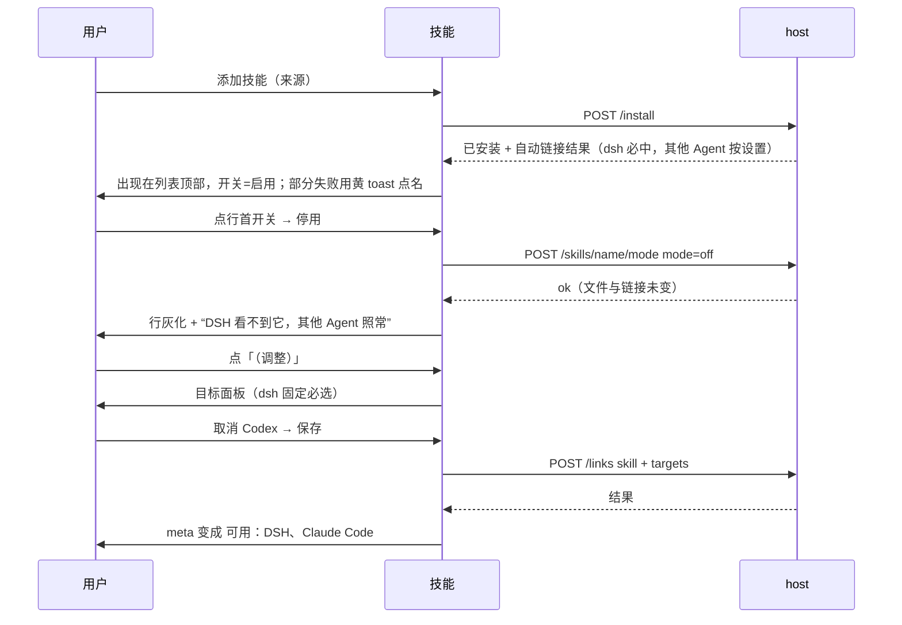

# 技能管理：界面原型设计（v10 · 终局）

- 日期：2026-10-23
- 上游设计：[2026-10-23-dsh-skills-manager-design.md](./2026-10-23-dsh-skills-manager-design.md)（后端契约以它为准；本文是界面终局）
- 状态：**草案待评 v3**（v1 双栏对账、诊断页、侧栏/输入框入口、更新计划弹层已裁；v3 加入两态启停、默认自动链接）
- 命名：包 `@morehao/dsh-skills-manager` / 插件 id `dsh-skills-manager` / 界面名**技能管理**（主文档 §15）
- 原型产物：`../prototypes/2026-10-23-dsh-skills-manager-prototype.html`

## 1. 结论

**一个页面，两个 tab，每个 tab 一个按钮；每行操作列 = 开关 + 更新 + 删除。**

```
「已装」tab                                     [添加技能]
              查看：[平铺] [按 Agent]        ← 分组只改组织方式，不改任何状态
┌ git-kit · 最新               [开关●] [更新]灰 [删除]
│ 来自 morehao/ai-kit#a1b2 · 可用：DSH、Claude Code（调整）
└ 页头：技能   [自动链接：DSH、Claude Code ▾]  [添加技能]
「订阅」tab                                     [添加订阅]
┌ ▸ morehao/ai-kit  main · 9 个技能 · 已装 8          [刷新] [删除]
└ 展开后逐个 [安装] / [更新]
```

三条原则：

1. **行内操作列只有三件东西**：开关（启用/停用）、更新、删除。链接不是按钮，是**页头一个设置 chip** + 行内「（调整）」文字链。
2. **开关放在操作列、不放行首**：行首留给名称与状态，扫列表时视线不该被可点控件打断。
3. **可以按 Agent 分组看**，但分组只是"同一批技能的另一种排法"，不产生任何新状态。
4. **每多一个需要解释的概念，就少一半人用**：所以「链接到 Agent」从按钮降级为文字链，只在需要例外时才谈。

## 2. 页面

挂载点：设置页的一个分区（`settings.section`，`id: "dsh-skills-manager"`，标题「技能」）。不占侧栏、不占输入框。

**页头右上角只放当前 tab 的按钮**：「已装」tab → 只有「添加技能」；「订阅」tab → 只有「添加订阅」。空状态页同样遵守。

```
┌──────────────────────────────────────────────────────────────────────────┐
│ 技能        [自动链接：DSH、Claude Code ▾]      [添加技能]         │
│ ┌────────────┬────────────┐                                              │
│ │ ● 已装（5）│  订阅（2）│                                              │
│ └────────────┴────────────┘                                              │
├──────────────────────────────────────────────────────────────────────────┤
│  ⚠ 1 个有新版本   [全部更新]        查看：[● 平铺] [○ 按 Agent]          │
│ ┌──────────────────────────────────────────────────────────────────────┐ │
│ │ git-kit · 最新                                [开关●] [更新]灰 [删除] │ │
│ │ 来自 morehao/ai-kit#a1b2 · 可用：DSH、Claude Code（调整）             │ │
│ ├──────────────────────────────────────────────────────────────────────┤ │
│ │ disk-cleanup · 有新版本 a1b2 → 9f02           [开关●] [更新] [删除]  │ │
│ │ 来自 morehao/ai-kit · 可用：DSH（调整）                              │ │
│ ├──────────────────────────────────────────────────────────────────────┤ │
│ │ handoff · 本地已改 + 已停用（整行灰化）        [开关○] [更新] [删除] │ │
│ │ 来自 morehao/ai-kit · 可用：DSH（调整）                              │ │
│ │ 停用中：DSH 看不到它，但已链接的 Claude Code 等 Agent 照常可用       │ │
│ ├──────────────────────────────────────────────────────────────────────┤ │
│ │ pdf-tools · 异常：链接断裂                     [开关●] [更新] [删除] │ │
│ │ 来自 vercel-labs/agent-skills · 可用：DSH（调整）                    │ │
│ └──────────────────────────────────────────────────────────────────────┘ │
└──────────────────────────────────────────────────────────────────────────┘
```

「按 Agent」分组视图（同一批技能，换一种组织方式）：

```
│  ⚠ 1 个有新版本   [全部更新]        查看：[○ 平铺] [● 按 Agent]          │
│ ┌──────────────────────────────────────────────────────────────────────┐ │
│ │ DSH（内置，全部可见）· 5 个技能                                       │ │
│ │   git-kit           最新                       [开关●] [更新]灰 [删除]│ │
│ │   disk-cleanup      有新版本                   [开关●] [更新] [删除] │ │
│ │   handoff           本地已改 · 已停用           [开关○] [更新] [删除] │ │
│ │   pdf-tools         异常：链接断裂              [开关●] [更新] [删除] │ │
│ ├──────────────────────────────────────────────────────────────────────┤ │
│ │ DSH（本项目）· 3 个技能                                              │ │
│ │   …                                                                  │ │
│ ├──────────────────────────────────────────────────────────────────────┤ │
│ │ Claude Code · 2 个技能                                               │ │
│ │   git-kit           最新                       [开关●] [更新]灰 [删除]│ │
│ │                                                                      │ │
│ └──────────────────────────────────────────────────────────────────────┘ │
```

分组规则：组序固定为 **DSH（全局链·已启用）→ DSH（仅特定项目）→ DSH 已停用 → 其他 Agent（按探测顺序，只列有链接的）**；一个技能接了多个目标时会在多个组里各出现一次（这是它的真实状态，不是重复 bug）；每行操作完全相同，切视图不影响任何状态。

前三个组直接照出"这个技能在 DSH 侧处于什么状态"：全局可见 / 只在那几个项目可见 / 已停用（链接已摘）。因为 DSH 全局链是默认必需（§4.1），不存在"没有任何 Agent 可用"的技能，原先那一组已删除。

「订阅」tab：

```
┌──────────────────────────────────────────────────────────────────────────┐
│ 技能                                             [添加订阅]         │
│ ┌────────────┬────────────┐                                              │
│ │  已装（5） │ ● 订阅（2）│                                              │
│ └────────────┴────────────┘                                              │
├──────────────────────────────────────────────────────────────────────────┤
│ ▸ morehao/ai-kit  main · 9 个技能 · 已装 8            [刷新] [删除]      │
│ ▾ vercel-labs/agent-skills  main · 6 个技能 · 已装 2  [刷新] [删除]      │
│      pdf-tools             已装                                         │
│      skill-creator         已装                                         │
│      web-design-guidelines 未装                          [安装]          │
└──────────────────────────────────────────────────────────────────────────┘
```

## 3. 行内三个控件

### 3.1 操作列开关：启用 / 停用（排在最左，紧跟其后是更新、删除）

| 状态 | 含义 | 视觉 |
| --- | --- | --- |
| **启用**（默认，`mode: "on"`） | 模型目录可见、`/name` 可用 | 开关打开，整行正常 |
| **停用**（`mode: "off"`） | 模型目录不可见、`/name` 不可用；**文件与链接都不动** | 开关关闭，行灰化但**留在列表**（必须能再打开），meta 追加一句"停用中：DSH 看不到它，但已链接的其他 Agent 照常可用" |

**它的实现是"DSH 侧链接的有 / 无"**（主文档 §14.2 / §16.3）：`off` 时移除 `~/.dsh/skills`（或项目目录）那条链接，于是模型目录没有它、`/` 菜单没有它、`/name` 也调不到；其他 Agent 的链接**不动**。`on` 时按 state 里记的作用范围原样重建，避免"启停一次就悄悄变全局"。原生 watch 会在下一个模型步骤刷新目录，所以文案写「将在下一步生效」而不是「已立即生效」。

三个必须写进文案的事实：

1. **停用只作用于 DSH 侧**——Claude Code 等已链接的 Agent 照常可用。否则用户会把停用当成全局开关，发现 Claude 还在用就以为功能坏了。
2. **停用不写 `SKILL.md`**——开关存在 插件 state。写进 frontmatter 会被下一次更新覆盖，还会让内容哈希变化 → 被判「本地已改」→ 更新永久锁死。
3. **更新不丢开关**——更新重建的是技能目录，`mode` 在 state 里，两者互不影响。

未链接到 DSH 的技能，开关禁用并提示「先链接到 DSH」（正常流程下不会出现，因为 dsh 两个目标是自动链接的）。

### 3.2 更新

按钮**永远叫「更新」**，一种动作一个名字。「本地已改」不是另一种功能，只是需要多问一句：

| 情形 | 按钮 | 行为 |
| --- | --- | --- |
| 有新版本 | `[更新]` | 行内「更新中…」→ toast：`已更新到 9f02 · 改动 7 个文件 · 备份 b7c8` |
| 已是最新 | `[更新]` 禁用 | — |
| 本地已改 | `[更新]` | 先弹确认：「本地有 2 处改动，更新会覆盖它们；旧内容已备份，可回滚到 b7c8」→ 确认后更新 |
| 更新失败 | — | 红 toast：`更新失败，已回滚到 a1b2` + 「详情」 |

**为什么取消「覆盖更新」这个文案**：它把"风险提示"写进了按钮名，等于用两个名字描述同一个动作，用户要额外记住"这两个按钮有什么区别"。风险应该在点击之后用一句话说明，而不是提前改标签。

### 3.3 删除（走 CLI）

**删除不由本插件直接 `rm`，而是调 `skills remove -s <name> -g -y`** —— 真身与各 Agent 目录里的条目由 CLI 清理，本插件只清自己记录的链接（dsh 两个目标 + 自定义目标）。这条和"canonical 只由 CLI 写"是同一个原则（主文档 I1）。

CLI 的真实语义带来两个必须处理的点（主文档 §4.4「删除序列」）：

1. **体检**：`remove` 会把**所有** Agent 目录下的同名条目 `rm -rf`，不区分软链与实体目录。所以点击删除前先检查：若某个 Agent 目录里是**真实目录**或**别人建的链接**，**中止删除**并提示"Cursor 里有一个不是本插件创建的 `foo`，继续会连带删掉它"。
2. **不带 `-a`**：传了反而删不掉真身（CLI 会认为"还有 Agent 在用"）。这只在实现层，用户看不到，但它决定删除是否真的生效。

用户可见的流程：

| 步骤 | 表现 |
| --- | --- |
| 点删除 | 二次确认：「会从本机移除 git-kit：断开本插件建的链接 → 调 CLI 卸载 → 目录先备份到回收站（保留 7 天）。**不会删除你的源仓库。**」 |
| 体检不过 | 确认弹层直接变成警告态，主按钮禁用，给出冲突目录与建议 |
| 成功 | toast：`已删除 git-kit（备份在回收站，保留 7 天）` |
| CLI 失败 | 红 toast + 「详情」；**已断开的本插件链接不回滚**（重建一次链接比保留半删状态更安全），在详情里说明 |

回收站是**本插件自己的目录**（`skills-manager/trash/`），由第 2 步的快照产生；恢复时若同名目录已存在，按冲突提示处理（覆盖 / 恢复为副本 / 取消）。

## 4. 链接到 Agent：从按钮降级为「（调整）」

### 4.1 默认策略

| 目标 | 默认 | 说明 |
| --- | --- | --- |
| **DSH 全局**（`~/.dsh/skills`，原生 rank 400） | **总是建立，不可取消** | 装进 canonical 却不在这个根里 = 对 DSH 等于没装。它是默认动作，不是选项 |
| 其他 Agent（Claude Code / Codex / Cursor…） | 跟随页头设置「自动链接」，**默认开** | 绝大多数人只想要"装完就能用" |
| 项目作用域 | **不自动** | 见 §4.4：项目是独立动作，不是默认体验 |

页头 chip 只管**其他** Agent（`自动链接：Claude Code`）：DSH 全局那条链是默认动作，不需要出现在"要不要自动链接"的设置里。

**本插件默认只关注全局技能。** 页头的「自动链接」列表里不会出现任何项目项。

设置入口在**页头**，紧挨主按钮：`[自动链接：DSH、Claude Code ▾]`。

为什么放页头而不是列表底部：这个设置决定的是"点『添加技能』之后会发生什么"，它属于**动作的前置条件**，就该待在动作旁边。放页面最下面时，用户不滚到底就永远不知道装完会往 `~/.claude/skills` 写东西——而那正是最容易让人意外的副作用。两个 tab 都保留这个 chip（订阅里的「安装」同样受它影响）。

### 4.2 单技能的例外：「接入设置」

**位置：行内操作列，用文字按钮**（不是 meta 行的文字链，也不是图标）。meta 行只放信息（`可用：DSH、Claude Code · 范围：仅 proj-a`），不再藏可点元素。操作列因此是：

```
[开关]  [更新]  [接入设置]  [删除]
```

为什么用文字而不是图标：图标（链环、齿轮之类）在这里没有行业共识，用户得先猜它是什么；而「接入设置」四个字直接说明"改的是接入"。宽度上多占约 50px，换来零学习成本，值得。

为什么改到操作列：① 行内所有"能改这个技能"的动作应该在一列，用户不用在 meta 里找；② meta 是读信息的，混入可点文字会让整行看起来都能点；③ 这个动作虽不常用，但一旦要用就是明确意图，必须看得见。

**为什么从「（调整）」改名**：「调整」没说清调的是什么（调内容？调状态？调链接？），而且和「更新」在语义上都能被理解成"改动这个技能"。改成「接入设置」后，宾语明确落在"接入"，动词是"设置"，和旁边的「更新」「删除」互不混淆。

为什么保留这个出口：自动往 `~/.claude/skills` 这类**不属于本插件**的目录写链接，如果没有撤销入口，就变成了不可撤销动作——用户只能去命令行 `rm`。多一个文字链，换掉的是"去终端手删软链"，这笔买卖不亏。

## 4.3 按 Agent 分组查看

「已装」tab 右上有一组视图开关：`[平铺] [按 Agent]`。**它只改组织方式，不改任何状态、不触发任何请求**（数据在 `GET /state` 里已有：每个技能带 `links[].target`）。

| 视图 | 排法 | 什么时候用 |
| --- | --- | --- |
| **平铺**（默认） | 一个列表，按名称或状态排 | "这个技能什么情况" |
| **按 Agent** | 组序：**DSH（内置，全部）** → 其他 Agent（探测顺序，仅列有技能的）→ 已接到项目的（每项目一组）；组内同平铺 | "Claude Code 能用哪些""这个仓库能用到哪些""哪些技能还没接给其他 Agent" |

两条规则：

1. **一个技能链接了多个 Agent，就在多个组里各出现一次**——这是它的真实状态，不是重复 bug；组头显示该组技能数，用来识别"这个 Agent 接了 12 个，那个只接了 2 个"。
2. 每行操作与平铺完全一致；开关在任何组里都可用（它控制的是 DSH 侧可见性，与"接给了哪些其他 Agent"正交）。

## 4.4 作用范围：全局 / 仅某些项目

**面板只有一个提交按钮。** 作用和 Agent 勾选同构，都是"这个技能接到哪"的一部分，所以放在同一个面板、由同一个「保存」提交——两个提交按钮（先「接到项目」再「保存」）会让用户不知道按哪个，也会出现"只按了一个"的半提交状态。

```
┌─────────────────────────────────────────────────┐
│ 接入设置 · git-kit                          [×] │
├─────────────────────────────────────────────────┤
│ 链接到哪些 Agent                                │
│   ☑ dsh（全局）     必选   ~/.dsh/skills        │
│   ☑ Claude Code          ~/.claude/skills       │
│   ☐ Codex                ~/.codex/skills        │
├─────────────────────────────────────────────────┤
│ 在 DSH 里的作用范围                             │
│   ● 全局（默认）                                │
│   ○ 仅以下项目（可多选）                        │
│      ☐ proj-a   ~/work/proj-a                   │
│      ☐ proj-b   ~/work/proj-b                   │
├─────────────────────────────────────────────────┤
│                               [取消]  [保存]    │
└─────────────────────────────────────────────────┘
```

三条设计判断：

1. **项目是多选，不是单选。** 同一份内部规范通常服务好几个仓库；单选会逼用户重复 N 次操作，还把状态打散成 N 条互不相干的记录。多选让"这个技能在哪些项目里有效"一处可见。
2. **它的实现是"链接写在哪"，不是状态过滤。** DSH 原生是**多根叠加 + rank 优先**（项目根 100 > 用户根 400，主文档 F28/§16.4）：全局链写进 `~/.dsh/skills`，项目链写进 `<project>/.dsh/skills`。所以「仅项目」= **只写项目链、不写全局链**；两条都写没有额外效果，因此 UI 做成单选——这是我们的写入策略，不是 DSH 的限制。
3. **与 Agent 链接正交**：可以"全局可见 + 只链给 Claude Code"，也可以"只在这两个项目里可见 + 链给全部 Agent"。两者互不约束。

细则：

| 项 | 规则 |
| --- | --- |
| 数据 | `scopeProjects: string[]`，空 = 全局；非空 = 只在这些项目根写链接。state 里同时记它，供启停后原样重建 |
| 项目来源 | 已登记工作区；项目根按原生定义（最近含 `.git` 的祖先），不接受手输路径 |
| 与开关的关系 | 行首开关为 `off` 时，作用范围段整体置灰（此时任何 cwd 都不可见，范围无意义） |
| 行内 meta | `可用：DSH、Claude Code · 范围：proj-a、proj-b`；全局时不显示"范围" |
| 提交 | 与 Agent 勾选一起由「保存」提交；保存后行内 meta 立刻反映 |

## 5. 两个按钮（按 tab 切换）## 5. 两个按钮（按 tab 切换）

| 按钮 | 位置 | 字段 | 提交后 |
| --- | --- | --- | --- |
| **添加技能** | 「已装」tab 右上 | 来源（`owner/repo#skill` / Git URL / 本地路径）+ 技能名（可空） | 走 `add` → 落 canonical → **自动链接**（按 §4.1）→ 出现在列表顶部，开关默认启用 |
| **添加订阅** | 「订阅」tab 右上 | `owner/repo` + `ref`（可空）+ 子目录（可空，折叠） | 只拉快照，不装任何东西；行出现在顶部，展开后逐个「安装」 |

弹层里各写一句差别：

- 添加技能：「会立即下载并写入本机技能目录（`~/.agents/skills`），并按底部的默认设置链接到 Agent。」
- 添加订阅：「只记录你关注这个仓库，不会安装任何技能。」

## 6. 状态标签（四个）

| 标签 | 判据 | 附加文案 |
| --- | --- | --- |
| **最新** | 上游树 SHA 与安装时一致 | `来自 owner/repo#commit` |
| **有新版本** | 上游变了 | `a1b2 → 9f02` |
| **本地已改** | 内容哈希与安装基线不一致 | 更新按钮变「覆盖更新」 |
| **异常** | 链接断裂 / 上游已删除 / 冲突 | 括号给原因 |

「停用」不是状态标签，是行首开关的位置——它回答"要不要用"，不是"上游变了没"。两者正交：一个技能可以"有更新且已停用"。

## 7. 反馈与异常

| 场景 | 表现 |
|---|---|
| 更新中 / 安装中 | 行内按钮「更新中…」，整行禁用；不弹进度框 |
| 更新成功 | toast：`disk-cleanup 已更新到 9f02 · 改动 7 个文件 · 备份 b7c8` |
| 更新失败已回滚 | 红 toast + 「详情」 |
| 本地已改时点「更新」 | 先弹确认（覆盖 N 处本地改动 + 备份 key），确认后才执行 |
| 停用 / 启用 | 立即生效，行灰化/恢复；无 toast（即时开关，弹提示反而吵） |
| 自动链接部分失败 | 安装成功 + 黄 toast：`已安装，但 Codex 里已有同名目录且不是本插件建的，已跳过` |
| 删除技能成功 | toast：`已删除 git-kit（备份在回收站，保留 7 天）` |
| 删除被体检拦截 | 确认弹层变警告态：`Cursor 里有一个不是本插件创建的 foo，继续会连带删掉它`，主按钮禁用 |
| 删除时 CLI 失败 | 红 toast + 「详情」；已断开的链接不自动重建（说明里给"重新添加"入口） |
| 切换平铺 / 按 Agent | 纯视觉，无请求、无状态变化 |
| 删除订阅 | toast：`已删除订阅 morehao/ai-kit（8 个已装技能保留）` |
| CLI 未安装 | 顶部红条 + 「？」悬浮安装说明（Node ≥ 22.20、`npm i -g skills` 或 `npx -y skills add …`，各带复制） |
| 离线 | 顶部灰条；写操作禁用；清单只读 |
| 空（技能） | 「还没有安装任何技能」+ 一个「添加技能」+ 一行 `npx skills add owner/repo` |
| 空（订阅） | 「还没有添加订阅」+ 一个「添加订阅」+ 一句"订阅只是关注，不安装" |
| 状态文件损坏 | 顶部橙条 + 只读；按钮全禁用 |

## 8. 交互流程



## 9. 后端需要的接口

| 用途 | 接口 |
| --- | --- |
| 单页数据 | `GET /state`（技能含 `mode` + 订阅 + 已探测 Agent + `settings.autoLinkAgents`） |
| 加技能 | `POST /install` |
| 加/删/刷新订阅 | `POST /subscriptions`、`DELETE /subscriptions/:id`、`POST /subscriptions/:id/refresh` |
| 安装订阅内的技能 | `POST /install`（带 `subscriptionId + skill + commit`） |
| 更新 | `POST /updates/apply` |
| 启停 | `POST /skills/:name/mode` |
| 调整链接 | `POST /links`（`targets[]` 可含 `project:<absPath>`，仅此处显式传入） |
| 删除技能 | `DELETE /skills/:name`（内部：体检 → 快照到回收站 → `skills remove -s <name> -g -y` → 清自家链接 → 清记账） |
| 默认链接设置 | 并入 `GET /state` 与 `POST /settings` |

`GET /diagnostics`、`POST /updates/plan` 不实现（对账进日志、不做差异预览）。

## 10. 原型交付物

`../prototypes/2026-10-23-dsh-skills-manager-prototype.html`：单文件零依赖。

- 两个 tab，页头只显示当前 tab 的按钮；空态跟随 tab
- 技能行：操作列 = 开关 + 更新 + 删除，meta 行有 `可用：… · 接入设置` 文字链；停用行灰化并留在列表
- 「更新」在本地已改时先弹确认（不再有「覆盖更新」这个第二标签）
- 视图开关 `[平铺] [按 Agent]`：按 Agent 时按 DSH 全局 / DSH 本项目 / 其他 Agent / 没有 Agent 可用 分组
- 删除走「体检 → 快照 → CLI remove → 清链接」，其中体检不通过时确认弹层变警告态
- 页头常驻 chip `自动链接：DSH、Claude Code ▾`，点开是"默认链接范围"（dsh 全局必选、其他可勾，保存后影响后续安装；**不含项目项**）
- 「（调整）」面板下半部分有「只在某个项目里使用」：选已登记项目 → 接到项目（独立动作）
- 可点：启停、更新（含失败回滚）、删除、调整链接、添加技能/订阅、订阅展开安装
- CLI 未安装场景带「？」悬浮安装说明；明暗主题切换；场景切换（正常/空态/CLI 缺失/离线/只读）

## 11. 评审要看什么

1. 一屏能否回答"装了哪些、哪些要更新、DSH 能不能用"；
2. 行首开关是否不需要解释就能懂（尤其"停用 ≠ 断开链接"那句 meta）；
3. 「接入设置」这个文字链是否够显眼但不抢按钮位置，且不会被误读成"更新"；
3b. 操作列里"开关 + 更新 + 删除"三件是否一眼分得清主次（开关最轻、删除最重）；
4. 页头的「自动链接」chip 是否足够显眼又不抢主按钮（它决定装完会往哪些目录写东西，是本页最容易被忽略的副作用开关）。

## 12. 版本演进

| 版本 | 变化 | 理由 |
|---|---|---|
| v1 | 双栏对账、诊断页、侧栏/输入框入口、更新计划弹层、8 状态 | 把低频诊断做成了主视图 |
| v2 | 单页两列表、4 状态、去掉诊断与计划弹层 | 主界面只回答日常三问 |
| v2.1 | 技能/订阅拆 tab，订阅加删除 | 两个列表叠一屏滚不动；能加不能删是硬伤 |
| v2.2 | 「接入」改名「链接到 Agent…」，状态改写「可用：DSH、Claude Code」 | 「接入」没人看得懂 |
| v2.3 | 页头按钮跟随 tab；CLI 缺失给「？」 | 同屏两个"新增"会诱使误点 |
| v3 | 加两态启停；链接从按钮降级为「（调整）」文字链 + 底部默认链接设置 | 启停是"先静音别删"的唯一出口；自动链接去掉一个必须理解的概念 |
| v4 | 开关移入操作列；新增「按 Agent」分组视图；**删除改为走 CLI**（体检 + 快照 + `skills remove`） | 行首不放控件，扫读不被打断；分组回答"某 Agent 能用哪些"；删除也必须遵守"canonical 只由 CLI 写" |
| v5 | 默认链接设置从列表底部移到**页头 chip**，紧挨主按钮 | 它决定"点添加之后会发生什么"，属于动作前置条件；放底部等于藏起来 |
| v6 | 默认只关注全局（去掉 dsh 本项目）；项目维度改为「接到项目」独立动作 | 项目维度是例外诉求，误设为默认会让"换个项目就看不见"成为默认体验 |
| v7 | DSH 改为内置可见（provider 直出，不再是链接目标）；「（调整）」→「接入设置」；取消「覆盖更新」标签 | 长在 DSH 上：DSH 本就不需要"被链接"；一个动作一个名字 |
| v8 | 取消「接到项目」按钮，并入「保存」；项目改多选 | 一个弹层只该有一个提交；多项目是常态 |
| v9 | 回退 provider 路线：DSH 全局链接恢复为默认必需；作用范围 = "链接写在哪"（原生多根 + rank 优先）；启停 = 链接有/无 | DSH 全局必须能立刻看见；原生策略写不了 frontmatter |
| **v10（终局）** | 「接入设置」在操作列用**文字按钮**（先前试过图标） | 图标无共识、需猜；四个字换来零学习成本 |
